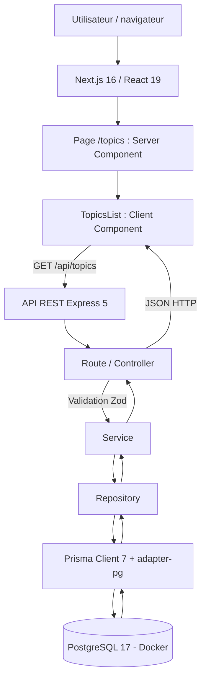
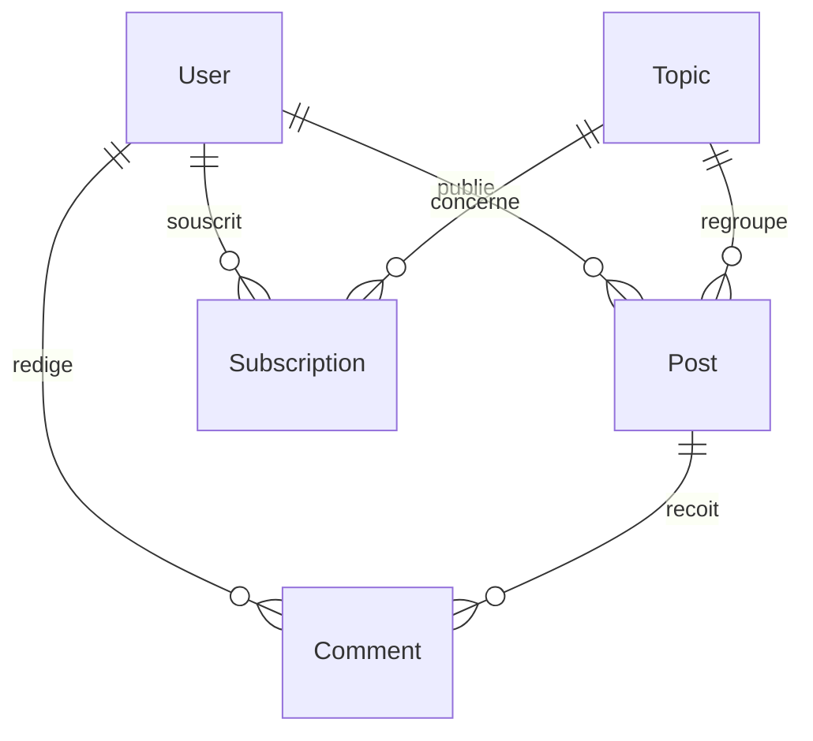

# Documentation et rapport technique — MDD (Monde de Dév)

**Projet :** P5 — OpenClassrooms, parcours Lead Developer JavaScript (RNCP 7)  
**Auteur :** Alain Bonneau  
**Version du document :** 0.6.0 — validation technique, tests E2E et couverture  
**Mise à jour :** 12/11/2026  
**Branches de référence :** `main` (MVP actuel) ; branche locale de validation et tests (à fusionner après revue).  
**Commit historique de l'étape 4 :** `29a92b2`  
**État :** fonctionnalités principales implémentées et vérifiées ; fil d'actualité filtré par abonnements non implémenté ; audits de performance et d'accessibilité à réaliser.

> **Périmètre de ce rapport :** l'étape 4 et les premières étapes de l'étape 5 restent documentées comme historique. Le bilan qualité daté du 12/11/2026 repose sur les sorties locales communiquées : **80 tests back-end, 34 tests front-end et 5 tests E2E réussis**, ainsi que des rapports de couverture Vitest. Les audits non exécutés ne sont pas présentés comme validés.

## Sommaire

1. [Présentation générale du projet](#1-présentation-générale-du-projet)
2. [Architecture et conception technique](#2-architecture-et-conception-technique)
3. [Tests, performance et qualité](#3-tests-performance-et-qualité)
4. [Documentation utilisateur et supervision](#4-documentation-utilisateur-et-supervision)
5. [Annexes et livrables](#5-annexes-et-livrables)

---

## 1. Présentation générale du projet

### 1.1 Objectifs du projet

MDD (Monde de Dév) est un réseau social destiné aux développeurs. Le MVP a pour objectif de permettre aux utilisateurs de consulter des thèmes liés à la programmation, de s'y abonner, de publier des articles et de participer à des échanges au moyen de commentaires.

Les principaux besoins métiers sont :

- **Découvrir** les sujets de programmation disponibles sur la plateforme.
- **Personnaliser** son expérience grâce aux abonnements aux thèmes.
- **Partager** des connaissances au moyen d'articles.
- **Échanger** autour des articles via les commentaires.

L'**étape 4** vise une preuve de fonctionnement limitée mais complète : afficher dans le navigateur une liste de thèmes obtenue depuis PostgreSQL, à travers le front-end Next.js et une API REST Express. Cette action valide la communication entre les différentes couches sans attendre l'implémentation du reste du MVP.

### 1.2 Périmètre fonctionnel et état d'avancement

| Fonctionnalité                     | Description                                                                                             | État au 12/11/2026                                                         |
| ---------------------------------- | ------------------------------------------------------------------------------------------------------- | -------------------------------------------------------------------------- |
| Consultation des thèmes            | Lecture de `Topic` depuis PostgreSQL, affichage sur `/topics`                                           | **Implémentée et vérifiée** ; accès réservé aux utilisateurs connectés     |
| Filtrage des thèmes dans l'API     | Paramètre facultatif `search` sur `GET /api/topics`                                                     | **Implémenté et vérifié manuellement**                                     |
| Interface et navigation responsive | Cartes, logo officiel, header et panneau latéral mobile conforme à la maquette                          | **Implémentés**, vérifications desktop et mobile rapportées comme réussies |
| Inscription et connexion           | Validation Zod, hachage Argon2, sessions PostgreSQL et cookies HttpOnly                                 | **Implémentées et vérifiées**                                              |
| Déconnexion et contrôle d'accès    | Destruction de session, `GET /api/auth/me`, `requireAuth`, CSRF, rate limiting                          | **Implémentés et vérifiés**                                                |
| Abonnement / désabonnement         | Relation utilisateur–thème, boutons « S'abonner » / « Déjà abonné »                                     | **Implémentés et vérifiés** ; persistance contrôlée dans DBeaver           |
| Articles                           | Liste et tri chronologique, publication, consultation détaillée                                         | **Implémentés** ; validation API et métier, essais manuels principaux      |
| Commentaires                       | Affichage par article et publication par l'utilisateur connecté                                         | **Implémentés** ; validation API et métier, persistance vérifiée en E2E    |
| Fil d'actualité personnalisé       | Articles correspondant aux thèmes suivis                                                                | À développer                                                               |
| Profil utilisateur                 | Consultation et mise à jour du compte, changement de mot de passe, affichage et gestion des abonnements | **Implémenté et validé** ; tests HTTP, React et E2E du profil réussis      |

**Note :** le schéma de base de données contient déjà les entités nécessaires aux fonctionnalités futures et des données de démonstration. Cela ne signifie pas que leurs interfaces ou leurs endpoints métier sont disponibles.

---

## 2. Architecture et conception technique

### 2.1 Schéma global de l'architecture

Le schéma ci-dessous retrace **le cas end-to-end initial de l'étape 4**. Depuis, la route `/topics` a été placée dans un groupe Next.js protégé et les accès aux thèmes sont soumis à authentification. Les abonnements, les articles, les commentaires et la modification du profil passent par les mêmes couches, avec une session utilisateur et un jeton CSRF pour les mutations.



Les pages `/articles`, `/articles/new`, `/articles/[id]` et `/profile` ont également été ajoutées au groupe protégé. La création d'un article ou d'un commentaire suit la chaîne navigateur → Express (`requireAuth`, CSRF et validation Zod) → Service → Repository → Prisma/PostgreSQL.

L'application est organisée en **monorepo** :

```text
mdd/
├── frontend/
│   ├── app/(protected)/topics/page.tsx
│   ├── app/(protected)/articles/
│   ├── app/(protected)/profile/page.tsx
│   ├── app/(protected)/layout.tsx
│   ├── app/login/page.tsx
│   ├── app/register/page.tsx
│   ├── components/layout/
│   ├── features/topics/components/
│   ├── features/articles/components/
│   ├── features/profile/components/
│   ├── features/auth/components/
│   ├── lib/api-client.ts
│   ├── tests/
│   ├── vitest.config.mts
│   └── package.json
├── backend/
│   ├── src/app.ts
│   ├── src/server.ts
│   ├── src/routes/
│   ├── src/controllers/
│   ├── src/services/
│   ├── src/repositories/
│   ├── src/middleware/
│   ├── src/lib/prisma.ts
│   ├── prisma/schema.prisma
│   ├── prisma/migrations/
│   ├── prisma/seed.ts
│   ├── tests/
│   ├── prisma7.config.ts
│   └── package.json
├── e2e/
│   ├── auth.navigation.spec.ts
│   ├── subscriptions.spec.ts
│   ├── articles-comments.spec.ts
│   └── registration-profile.spec.ts
├── scripts/
│   ├── e2e-env.mjs
│   ├── prepare-e2e-db.mjs
│   ├── cleanup-e2e-article.mjs
│   └── cleanup-e2e-user.mjs
├── docs/
├── docker-compose.yml
├── docker-compose.e2e.yml
├── playwright.config.ts
├── .env.example
├── .env.e2e.example
├── package.json
├── README.md
└── DOCUMENTATION.md
```

**Responsabilités :**

- **Client Component React :** déclenche les requêtes, affiche les données et gère les états de chargement, d'erreur et de sauvegarde.
- **Next.js App Router :** organise les pages publiques et le groupe `(protected)`, qui contrôle la session avant d'afficher les pages privées.
- **Express / Router / Controller :** expose les endpoints HTTP, applique l'authentification, la protection CSRF et les limites de requêtes, puis valide les entrées avec Zod.
- **Service :** porte la logique métier et traduit les cas d'erreur.
- **Repository :** centralise les opérations Prisma.
- **Prisma / PostgreSQL :** fournit l'accès typé et persistant aux utilisateurs, thèmes, abonnements, articles et commentaires.
- **`connect-pg-simple` :** conserve les sessions Express dans PostgreSQL.

### 2.2 Choix techniques et justifications

| Élément                                 | Rôle                     | Justification et compromis                                                     |
| --------------------------------------- | ------------------------ | ------------------------------------------------------------------------------ |
| Next.js 16, App Router                  | Front-end et routage     | Structure de pages et séparation Server / Client Components                    |
| React 19 + TypeScript                   | Interface et typage      | Composants réutilisables et détection précoce d'erreurs                        |
| Express 5                               | API REST indépendante    | Séparation front/back, clients multiples possibles et tests d'API indépendants |
| Prisma 7 + `@prisma/adapter-pg`         | ORM                      | Modèles typés, migrations versionnées et requêtes structurées                  |
| PostgreSQL 17                           | Base relationnelle       | Relations et contraintes adaptées au réseau social                             |
| Docker Compose                          | Environnements locaux    | Reproductibilité du développement et des tests E2E                             |
| Zod 4                                   | Validation               | Validation stricte des requêtes HTTP et des données reçues                     |
| Tailwind CSS 4                          | Interface                | Adaptation aux maquettes desktop et mobile                                     |
| Helmet et CORS                          | Sécurité HTTP            | En-têtes de protection et contrôle des origines autorisées                     |
| Argon2                                  | Mots de passe            | Hachage et vérification sécurisée des mots de passe                            |
| `express-session` + `connect-pg-simple` | Authentification         | Cookie HttpOnly et session persistée côté serveur                              |
| Protection CSRF                         | Sécurité des mutations   | Jeton associé à la session pour les requêtes de modification                   |
| `express-rate-limit`                    | Limitation des requêtes  | Protection contre les tentatives répétées d'authentification                   |
| Vitest + Supertest                      | Tests back-end           | Contrôle des services et du comportement HTTP                                  |
| React Testing Library                   | Tests front-end          | Vérification des interactions des composants                                   |
| Playwright                              | Tests E2E                | Parcours navigateur complets avec persistance PostgreSQL                       |
| GitHub Flow                             | Gestion du développement | Branches, Pull Requests, revue et fusion dans `main`                           |

**Choix Express plutôt que Server Actions :**

Le projet utilise une API REST Express indépendante. Cette architecture permet de traverser explicitement la chaîne front-end → back-end → base de données.

Ce choix présente plusieurs avantages : séparation des responsabilités, API réutilisable, testabilité des endpoints et indépendance du back-end.

En contrepartie, il impose une configuration CORS, une gestion explicite des sessions entre services et le déploiement de deux applications.

L'écart avec les exemples de Server Actions proposés dans certaines ressources pédagogiques doit être présenté au mentor pour confirmer sa conformité aux critères d'évaluation.

### 2.3 API REST et schémas de données

#### Endpoints disponibles

| Endpoint                      | Méthode | Fonction                                     |
| ----------------------------- | ------- | -------------------------------------------- |
| `/api/health`                 | GET     | Vérification du service Express              |
| `/api/health/db`              | GET     | Vérification de PostgreSQL                   |
| `/api/topics`                 | GET     | Liste des thèmes                             |
| `/api/topics?search=react`    | GET     | Recherche de thèmes                          |
| `/api/auth/csrf`              | GET     | Récupération du jeton CSRF                   |
| `/api/auth/register`          | POST    | Inscription                                  |
| `/api/auth/login`             | POST    | Connexion                                    |
| `/api/auth/me`                | GET     | Consultation du compte connecté              |
| `/api/auth/me`                | PATCH   | Modification du profil                       |
| `/api/auth/logout`            | POST    | Déconnexion                                  |
| `/api/subscriptions`          | GET     | Consultation des abonnements                 |
| `/api/subscriptions`          | POST    | Abonnement à un thème                        |
| `/api/subscriptions/:topicId` | DELETE  | Désabonnement                                |
| `/api/articles`               | GET     | Liste des articles                           |
| `/api/articles?sort=oldest`   | GET     | Articles triés du plus ancien au plus récent |
| `/api/articles/:id`           | GET     | Détail d'un article                          |
| `/api/articles`               | POST    | Publication d'un article                     |
| `/api/articles/:id/comments`  | POST    | Publication d'un commentaire                 |

Les routes métier privées nécessitent une session authentifiée.

Le `userId` utilisé pour les abonnements, articles et commentaires provient de la session Express. Il n'est jamais choisi librement par le client.

Les mutations sont protégées par un jeton CSRF.

#### Validation des données

**Thèmes :**

Le paramètre `search` est facultatif, limité à 100 caractères.

Le contrôleur utilise `z.strictObject()` pour rejeter les paramètres inattendus.

Une recherche insensible à la casse est effectuée dans PostgreSQL. Les résultats sont triés alphabétiquement et limités à 50 entrées.

**Exemple de réponse :**

```json
{
  "data": [
    {
      "id": "b973d172-6221-4246-b91c-1bb8ccda1a74",
      "name": "React",
      "description": "Bibliothèque de création d'interfaces."
    }
  ]
}
```

Une recherche sans résultat renvoie :

```json
{
  "data": []
}
```

Une requête contenant un paramètre non prévu, comme `search[]=React`, doit recevoir HTTP 400.

**Articles :**

- Titre : 5 à 255 caractères.
- Contenu : 20 à 10 000 caractères.
- Thème : UUID valide.
- Auteur : utilisateur authentifié.
- Tri : `newest` ou `oldest`.
- Article absent : HTTP 404.

**Commentaires :**

- Contenu non vide, limité à 2 000 caractères.
- Article identifié par un UUID.
- Auteur récupéré depuis la session.
- Identifiant invalide : HTTP 400.
- Article absent : HTTP 404.

**Profil :**

La modification du profil nécessite un compte connecté, un jeton CSRF et le mot de passe actuel.

Le pseudo, l'email et le nouveau mot de passe éventuel sont validés par Zod.

Argon2 vérifie le mot de passe actuel et hache le nouveau.

Les erreurs sont différenciées :

- HTTP 400 : données invalides.
- HTTP 401 : session ou mot de passe invalide.
- HTTP 409 : pseudo ou email déjà utilisé.

Le hash du mot de passe n'est jamais retourné au navigateur.

#### Modèle relationnel

Le schéma Prisma définit cinq modèles métier.

| Modèle         | Identifiant / contrainte          | Relations                           |
| -------------- | --------------------------------- | ----------------------------------- |
| `User`         | UUID, email et pseudo uniques     | Articles, commentaires, abonnements |
| `Topic`        | UUID, nom unique                  | Articles, abonnements               |
| `Subscription` | Clé composite `userId`, `topicId` | Utilisateur et thème                |
| `Post`         | UUID                              | Auteur, thème, commentaires         |
| `Comment`      | UUID                              | Auteur et article                   |



La migration initiale est versionnée dans `backend/prisma/migrations/`.

Le seed `backend/prisma/seed.ts` initialise :

- Deux utilisateurs fictifs.
- Quatre thèmes.
- Quatre abonnements.
- Deux articles.
- Deux commentaires.

Aucune nouvelle migration Prisma n'a été nécessaire pour les abonnements, les articles, les commentaires ou la modification du profil, les modèles étant déjà disponibles.

---

## 3. Tests, performance et qualité

### 3.1 Stratégie de test et résultats

La démarche de validation repose sur trois niveaux complémentaires :

1. **Tests unitaires et de composants :** vérification des règles métier et des interactions isolées.
2. **Tests HTTP :** vérification des endpoints Express, des statuts HTTP, de la validation et des protections.
3. **Tests E2E :** exécution réelle des parcours utilisateur dans Chromium avec Express et PostgreSQL.

Les tests ont été exécutés localement par le développeur sous Windows, avec PowerShell.

#### Bilan automatisé au 12 novembre 2026

| Suite      | Outils                        | Tests réussis | Fichiers |
| ---------- | ----------------------------- | ------------: | -------: |
| Back-end   | Vitest, Supertest             |            80 |       10 |
| Front-end  | Vitest, React Testing Library |            34 |        5 |
| End-to-end | Playwright, Chromium          |             5 |        4 |
| **Total**  |                               |       **119** |   **19** |

Toutes les suites rapportées ont terminé sans échec.

#### Tests back-end

Les 80 tests portent notamment sur :

- Authentification et gestion des sessions.
- Hachage Argon2.
- Validation des données.
- Protection CSRF.
- Limitation des tentatives de connexion.
- Contrôle des accès.
- Abonnements.
- Articles et commentaires.
- Consultation et modification du profil.
- Gestion des erreurs métier.

Les tests des contrôleurs et services utilisent principalement des dépendances simulées.

Ils permettent de tester rapidement la logique métier et les réponses HTTP, mais ne garantissent pas à eux seuls le bon fonctionnement des requêtes Prisma sur PostgreSQL.

#### Tests front-end

Les 34 tests React concernent cinq composants :

| Composant           |  Tests |
| ------------------- | -----: |
| `LoginForm`         |      5 |
| `RegisterForm`      |      8 |
| `TopicsList`        |      7 |
| `CreateArticleForm` |      6 |
| `ProfilePage`       |      8 |
| **Total**           | **34** |

Ces tests vérifient notamment :

- Les validations des formulaires.
- Le refus des données invalides.
- La gestion des erreurs réseau.
- Les réponses HTTP d'erreur.
- La soumission des formulaires.
- Les messages de confirmation.
- La mise à jour des informations du profil.
- Les interactions avec les abonnements.

Les appels API sont simulés afin de tester le comportement des composants de façon isolée.

#### Tests E2E Playwright

Cinq parcours ont été validés :

| Test                     | Scénario                                                             | Résultat |
| ------------------------ | -------------------------------------------------------------------- | -------- |
| Accès non authentifié    | Redirection de `/topics` vers `/login`                               | Réussi   |
| Connexion                | Authentification et navigation dans le MVP                           | Réussi   |
| Abonnements              | Abonnement, actualisation, vérification du profil, désabonnement     | Réussi   |
| Articles et commentaires | Création, publication, actualisation et vérification de persistance  | Réussi   |
| Inscription et profil    | Création de compte, connexion, modification du profil et persistance | Réussi   |

Les tests utilisent les véritables serveurs Next.js et Express ainsi qu'une base PostgreSQL dédiée.

Les résultats obtenus confirment le fonctionnement des principaux parcours du MVP de bout en bout.

### 3.2 Performance et optimisations

Aucun score Lighthouse ni mesure de charge chiffrée n'a encore été produit.

Plusieurs optimisations sont néanmoins présentes dans le code :

- Les repositories sélectionnent uniquement les champs nécessaires.
- Les listes de thèmes et d'articles sont limitées à 50 résultats.
- Les listes d'articles utilisent des extraits de contenu au lieu du texte intégral.
- Le tri chronologique est effectué côté back-end/base de données.
- `AbortController` annule les requêtes front-end lorsque les composants sont démontés.
- Les erreurs de chargement disposent de messages explicites et de mécanismes de nouvelle tentative.
- Next.js et Express peuvent être compilés et démarrés indépendamment.

**Limites identifiées :**

- Absence de pagination pour les grands volumes.
- Absence de mesure de performance sous charge.
- Absence de résultats Lighthouse.
- Optimisations de cache à évaluer selon l'évolution de l'application.

Ces éléments sont conservés comme pistes d'amélioration et ne sont pas considérés comme validés.

### 3.3 Revue technique

La revue technique examine le comportement des API, la conformité aux maquettes et la séparation des responsabilités.

| Observation                                                   | Risque ou écart                               | Décision                                          |
| ------------------------------------------------------------- | --------------------------------------------- | ------------------------------------------------- |
| Utilisation initiale de `z.object()` pour les paramètres HTTP | Paramètres inconnus silencieusement acceptés  | Passage à `z.strictObject()`                      |
| Interface Thèmes initialement différente de Figma             | Non-conformité visuelle                       | Correction du header, des cartes et du responsive |
| Actions d'abonnement initialement non développées             | Risque de boutons sans véritable comportement | Implémentation complète côté API et React         |
| Authentification nécessaire pour les pages privées            | Accès non autorisé                            | Layout protégé et middleware `requireAuth`        |
| Mutations HTTP sensibles                                      | Risque CSRF                                   | Jetons CSRF liés à la session                     |
| Tests manuels uniquement à l'étape 4                          | Risque de régression                          | Ajout de Vitest, Supertest et Playwright          |
| Tests de services avec repositories simulés                   | Faible couverture des accès réels à la base   | Complément par les parcours E2E PostgreSQL        |
| Multiples fichiers `package-lock.json`                        | Avertissement Next.js concernant le workspace | Configuration Turbopack à clarifier               |
| Dimensionnement de `/logo.png`                                | Avertissement Next.js sur le ratio d'image    | Vérifier la cohérence CSS des dimensions          |

La revue détaillée de l'étape 4 est conservée dans :

`docs/REVUE_TECHNIQUE_ETAPE_4_MDD.md`

---

## 4. Documentation utilisateur et supervision

### 4.1 FAQ utilisateur

**Comment accéder aux thèmes ?**

Démarrer PostgreSQL et l'application, se connecter puis ouvrir `/topics`.

Sans session valide, l'utilisateur est redirigé vers `/login`.

**Comment s'abonner à un thème ?**

Ouvrir la page Thèmes et cliquer sur « S'abonner ».

Le bouton devient « Déjà abonné ». Une nouvelle action permet de se désabonner.

L'état est conservé dans PostgreSQL.

**Comment publier un article ?**

Ouvrir `/articles`, sélectionner « Créer un article », renseigner le thème, le titre et le contenu, puis valider.

L'article apparaît ensuite dans la liste.

**Comment commenter un article ?**

Ouvrir son détail, renseigner le commentaire et utiliser le bouton d'envoi.

Le commentaire est associé à l'utilisateur authentifié et à l'article consulté.

**Comment modifier son profil ?**

Ouvrir `/profile`, modifier le pseudo ou l'adresse email, saisir le mot de passe actuel et sauvegarder.

Le changement de mot de passe est facultatif.

**Comment retrouver ses abonnements ?**

Les thèmes suivis sont affichés en bas du profil avec une action de désabonnement.

**Que faire si une page n'affiche pas ses données ?**

Vérifier le fonctionnement de Docker, PostgreSQL et Express.

L'endpoint `/api/health/db` permet de contrôler la disponibilité de la base.

Les composants concernés affichent un message d'erreur et peuvent proposer une nouvelle tentative.

### 4.2 Supervision et tâches déléguées à l'IA

Dans le cadre du projet P5, ChatGPT a été utilisé comme assistant de développement et de documentation.

Les tâches confiées ont porté notamment sur :

- Proposition de structures de composants React.
- Proposition de contrôleurs, services et repositories.
- Identification de scénarios de tests.
- Rédaction initiale de tests Vitest et Playwright.
- Analyse des erreurs de configuration.
- Proposition d'une architecture PostgreSQL E2E isolée.
- Analyse des rapports de couverture.
- Préparation de la documentation technique.

La supervision du développeur a consisté à :

- Définir les besoins et les contraintes.
- Vérifier les propositions par rapport aux maquettes Figma.
- Examiner et intégrer le code.
- Corriger les problèmes observés.
- Exécuter les tests.
- Vérifier les résultats des commandes.
- Décider des modifications conservées.

Plusieurs propositions initiales ont nécessité des corrections, notamment la conformité visuelle de l'interface et la configuration des tests.

La mise en place des tests E2E a également nécessité des ajustements du répertoire d'exécution de Prisma et du chargement des variables d'environnement.

**Conclusion :** les propositions de l'IA ne sont pas considérées comme validées sans vérification. Le développeur reste responsable des choix techniques et de la livraison.

---

## 5. Annexes et livrables

### 5.1 Livrables de l'étape 4

| Élément                                    | État                            |
| ------------------------------------------ | ------------------------------- |
| Application front-end fonctionnelle        | Réalisée                        |
| API Express indépendante                   | Réalisée                        |
| Communication avec PostgreSQL              | Réalisée                        |
| Architecture technique documentée          | Réalisée                        |
| Revue du travail délégué à l'IA            | Documentée                      |
| Vérification des premières fonctionnalités | Réalisée                        |
| Export PDF de la documentation             | À effectuer pour le dépôt final |

### 5.2 Pièces justificatives

Les preuves à conserver pour la soutenance sont :

- Captures des interfaces desktop et mobile.
- Résultats des tests back-end.
- Résultats des tests front-end.
- Résultats Playwright.
- Tableaux de couverture Vitest.
- Vérification du conteneur PostgreSQL E2E.
- Captures des validations `lint`, `typecheck` et `build`.
- Pull Requests fusionnées sur GitHub.
- Compte rendu de revue technique.
- Audits Lighthouse et accessibilité lorsqu'ils auront été exécutés.

### 5.3 Étape 5.1 — Authentification

**Objectif :** permettre l'inscription, la connexion et la gestion sécurisée des sessions.

Fonctionnalités réalisées :

- Inscription avec validation Zod.
- Hachage des mots de passe par Argon2.
- Connexion et création de session.
- Consultation de l'utilisateur connecté.
- Déconnexion.
- Protection CSRF.
- Limitation des tentatives de connexion.
- Protection des routes privées.

**Validation :** 15 tests back-end d'authentification et de limitation ont été validés au cours du développement.

Les parcours de connexion et d'inscription ont également été vérifiés avec Playwright le 12 novembre 2026.

### 5.4 Étape 5.2 — Abonnements

**Objectif :** permettre à un utilisateur connecté de suivre des thèmes.

Fonctionnalités réalisées :

- Consultation des abonnements.
- Abonnement.
- Désabonnement.
- Gestion des doublons.
- Persistance dans PostgreSQL.
- Mise à jour de l'interface sans rechargement manuel.

**Validation :** 17 tests back-end consacrés au module ont été validés.

Le parcours complet abonnement/désabonnement avec persistance a ensuite été vérifié en E2E.

### 5.5 Étape 5.3 — Articles et commentaires

**Objectif :** permettre la publication et la consultation d'articles ainsi que les échanges par commentaires.

Fonctionnalités réalisées :

- Liste d'articles.
- Tri chronologique.
- Formulaire de création.
- Consultation détaillée.
- Publication de commentaires.
- Validation des données.
- Gestion des droits d'accès.

**Validation :** 31 tests back-end consacrés aux articles et commentaires ont été exécutés avec succès.

Un test Playwright confirme également la création d'un article, la publication d'un commentaire et leur persistance après rechargement.

### 5.6 Étape 5.4 — Profil utilisateur et navigation mobile

**Objectif :** permettre la consultation et la modification du compte, ainsi que la gestion des abonnements.

Fonctionnalités réalisées :

- Affichage du pseudo et de l'email.
- Modification des informations du compte.
- Vérification du mot de passe actuel.
- Changement facultatif de mot de passe.
- Affichage des thèmes suivis.
- Désabonnement depuis le profil.
- Navigation responsive adaptée aux maquettes Figma.

**Sécurité :**

Le profil nécessite une session authentifiée et les mutations sont protégées par CSRF.

La mise à jour du compte requiert une vérification du mot de passe actuel.

**Validation :**

- 10 tests HTTP.
- 7 tests métier.
- 8 tests React du composant Profil.
- Un parcours E2E couvrant l'inscription et la modification du profil.

### 5.7 Bilan qualité et reproductibilité des tests

**Date des résultats : 12 novembre 2026.**

#### 5.7.1 Résultats

| Niveau    | Tests réussis | Outils                        |
| --------- | ------------: | ----------------------------- |
| Back-end  |            80 | Vitest, Supertest             |
| Front-end |            34 | Vitest, React Testing Library |
| E2E       |             5 | Playwright, Chromium          |
| **Total** |       **119** |                               |

Le nombre de tests réussis démontre l'exécution des scénarios préparés, mais ne constitue pas à lui seul un indicateur de couverture du code.

#### 5.7.2 Environnement de test isolé

Les tests Playwright disposent d'une infrastructure distincte de l'environnement de développement.

| Composant       | Développement        | E2E                      |
| --------------- | -------------------- | ------------------------ |
| Next.js         | `localhost:3000`     | `localhost:3100`         |
| Express         | `localhost:4000`     | `localhost:4100`         |
| PostgreSQL      | `mdd_db`             | `mdd_e2e_db`             |
| Port PostgreSQL | 5433                 | 5434                     |
| Docker Compose  | `docker-compose.yml` | `docker-compose.e2e.yml` |

La base de test possède son propre conteneur, son volume et ses données.

Le fichier `.env.e2e` contient les variables spécifiques aux tests et n'est pas versionné.

Le script `scripts/e2e-env.mjs` construit explicitement l'URL de connexion à la base E2E.

Le script `scripts/prepare-e2e-db.mjs` applique les migrations Prisma puis initialise les données fictives.

**Démarrage :**

```powershell
npm run db:e2e:up
npm run db:e2e:prepare
```

**Exécution :**

```powershell
npm run test:e2e
```

**Rapport Playwright :**

```powershell
npm run test:e2e:report
```

**Arrêt de la base :**

```powershell
npm run db:e2e:down
```

Les tests qui créent des données utilisent un nettoyage ciblé :

- Suppression de l'article E2E créé.
- Suppression de ses commentaires par cascade.
- Suppression du compte fictif temporaire.
- Rétablissement de l'état initial de l'abonnement testé.

Une interruption brutale peut néanmoins laisser des données temporaires. Une purge sécurisée et strictement limitée à la base E2E reste une amélioration possible.

#### 5.7.3 Couverture du code

Les rapports ont été produits avec Vitest et le moteur de couverture V8.

**Front-end :**

| Indicateur   |  Couverture |
| ------------ | ----------: |
| Instructions |     53,58 % |
| Branches     |     45,17 % |
| Fonctions    |     46,49 % |
| Lignes       | **54,75 %** |

**Back-end :**

| Indicateur   |  Couverture |
| ------------ | ----------: |
| Instructions |     74,04 % |
| Branches     |     65,90 % |
| Fonctions    |     65,57 % |
| Lignes       | **74,38 %** |

Le périmètre front-end comprend les fichiers des dossiers `app`, `features`, `components` et `lib`.

Le périmètre back-end comprend le code applicatif du dossier `src`, hors code Prisma généré et fichier de démarrage du serveur.

#### 5.7.4 Analyse de la couverture front-end

| Composant                 | Lignes couvertes |
| ------------------------- | ---------------: |
| `register-form.tsx`       |          97,77 % |
| `create-article-form.tsx` |          94,73 % |
| `login-form.tsx`          |          92,50 % |
| `profile-page.tsx`        |          86,79 % |
| `topics-list.tsx`         |          82,97 % |

Les composants testés individuellement disposent d'une bonne couverture.

Le taux global reste inférieur, car plusieurs fichiers ne sont pas encore importés par les tests Vitest :

- Pages Next.js.
- Layout de protection.
- Navigation principale.
- Liste des articles.
- Détail des articles.
- Client HTTP `api-client.ts`.

Certains de ces comportements sont déjà exercés par Playwright, mais les exécutions Playwright ne sont pas automatiquement intégrées au rapport Vitest.

#### 5.7.5 Analyse de la couverture back-end

| Couche       | Lignes couvertes |
| ------------ | ---------------: |
| Services     |          88,60 % |
| Contrôleurs  |          73,79 % |
| Repositories |          19,04 % |

Les services métier sont relativement bien couverts.

Les repositories sont beaucoup moins couverts, principalement parce que les tests Vitest utilisent des mocks pour isoler les services.

Les tests Playwright démontrent néanmoins que les opérations Prisma fonctionnent avec une véritable base PostgreSQL.

Cela ne signifie pas que chaque méthode de repository dispose d'un test d'intégration individuel.

#### 5.7.6 Qualité du code

Les contrôles techniques effectués comprennent :

- ESLint sur le front-end.
- Vérification TypeScript.
- Compilation Next.js.
- Compilation Express.
- Tests Vitest.
- Tests Playwright.
- Couverture V8.

Le 12 novembre 2026, ESLint a terminé avec **0 erreur et 2 avertissements**, provenant de fichiers JavaScript générés dans `frontend/coverage/`.

L'exclusion suivante doit être présente dans `frontend/eslint.config.mjs` :

```javascript
globalIgnores([
  ".next/**",
  "out/**",
  "build/**",
  "coverage/**",
  "next-env.d.ts",
]);
```

Le lint devra être relancé après cette modification.

Le build et le typecheck finaux doivent également être réexécutés avant la fusion.

#### 5.7.7 Limites et améliorations possibles

Les points suivants sont identifiés :

- Couverture Vitest incomplète sur plusieurs composants de consultation.
- Faible couverture des repositories.
- Absence de mesure Lighthouse.
- Absence de tests de charge.
- Absence d'audit d'accessibilité complet.
- Nettoyage E2E à renforcer en cas d'interruption brutale.
- Avertissement Next.js sur la présence de plusieurs lockfiles.
- Avertissement Next.js sur les dimensions CSS du logo.
- Fil d'actualité filtré par abonnements restant à implémenter selon le périmètre fonctionnel attendu.

Ces limites sont documentées pour permettre une amélioration progressive et une présentation transparente lors de la soutenance.

#### 5.7.8 Commandes de vérification

**Tests front-end :**

```powershell
npm --prefix frontend run test
npm --prefix frontend run test:coverage
```

**Tests back-end :**

```powershell
npm --prefix backend run test
npm --prefix backend run test:coverage
```

**Tests E2E :**

```powershell
npm run db:e2e:up
npm run db:e2e:prepare
npm run test:e2e
```

**Contrôles complémentaires :**

```powershell
npm --prefix frontend run lint
npm --prefix backend run typecheck
npm run build
```

#### 5.7.9 Conclusion de la campagne de tests

Les **119 tests réussis** constituent une base de validation et de non-régression pour les principales fonctionnalités de MDD.

La stratégie combine tests isolés, tests HTTP et parcours navigateur avec une véritable base PostgreSQL.

Les taux de couverture mettent également en évidence les éléments restant à renforcer.

La démarche ne revendique pas une couverture exhaustive de l'application. Elle démontre la mise en place de contrôles reproductibles, l'analyse de leurs résultats et l'identification des axes d'amélioration.

---

## 6. Références du projet

- [Dépôt GitHub MDD](https://github.com/AlainDev97/DFSJS-Prenez-en-charge-le-d-veloppement-d-une-application-full-stack-JavaScript-compl-te)
- [Code de l'étape 4](https://github.com/AlainDev97/DFSJS-Prenez-en-charge-le-d-veloppement-d-une-application-full-stack-JavaScript-compl-te/tree/feature/topics-e2e)
- [Compte rendu de revue technique](docs/REVUE_TECHNIQUE_ETAPE_4_MDD.md)
- [Documentation Next.js](https://nextjs.org/docs)
- [Documentation Express](https://expressjs.com/)
- [Documentation Prisma](https://www.prisma.io/docs)
- [Documentation Vitest](https://vitest.dev/)
- [Documentation Playwright](https://playwright.dev/)

_Document évolutif — dernière mise à jour : 12/11/2026._
