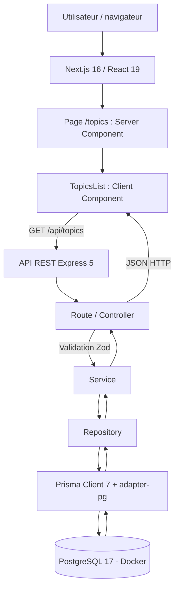
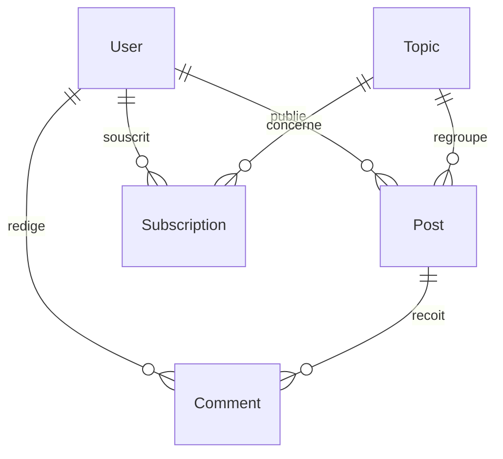

# Documentation et rapport technique — MDD (Monde de Dév)

**Projet :** P5 — OpenClassrooms, parcours Lead Developer JavaScript (RNCP 7)  
**Auteur :** Alain Bonneau
**Version du document :** 0.2.0 — première fonctionnalité end-to-end  
**Mise à jour :** 03/11/2026  
**Branche de référence :** `feature/topics-e2e`  
**Commit de référence :** `29a92b2`  
**État :** rapport de l'étape 4, à enrichir au fil du MVP

> **Périmètre de ce rapport :** distinguer les fonctionnalités réellement développées de celles prévues. Les tests manuels et commandes signalés comme réussis ont été exécutés et confirmés par le développeur ; aucun résultat de test automatisé ou de mesure de performance n'est présumé.

## Sommaire

1. [Présentation générale du projet](#1-présentation-générale-du-projet)
2. [Architecture et conception technique](#2-architecture-et-conception-technique)
3. [Tests, performance et qualité](#3-tests-performance-et-qualité)
4. [Documentation utilisateur et supervision](#4-documentation-utilisateur-et-supervision)
5. [Annexes et livrables](#5-annexes-et-livrables)

---

## 1. Présentation générale du projet

### 1.1 Objectifs du projet

MDD (Monde de Dév) est un réseau social destiné aux développeurs. Le MVP a pour objectif de permettre aux utilisateurs de consulter des thèmes liés à la programmation, de s'y abonner, de publier des articles et de participer à des échanges au moyen de commentaires.

Les principaux besoins métiers sont :

- **Découvrir** les sujets de programmation disponibles sur la plateforme.
- **Personnaliser** son expérience grâce aux abonnements aux thèmes.
- **Partager** des connaissances au moyen d'articles.
- **Échanger** autour des articles via les commentaires.

L'**étape 4** vise une preuve de fonctionnement limitée mais complète : afficher dans le navigateur une liste de thèmes obtenue depuis PostgreSQL, à travers le front-end Next.js et une API REST Express. Cette action valide la communication entre les différentes couches sans attendre l'implémentation du reste du MVP.

### 1.2 Périmètre fonctionnel et état d'avancement

| Fonctionnalité                 | Description                                                       | État au 03/11/2026                                                    |
| ------------------------------ | ----------------------------------------------------------------- | --------------------------------------------------------------------- |
| Consultation des thèmes        | Lecture de `Topic` depuis PostgreSQL, affichage sur `/topics`     | **Implémentée et vérifiée manuellement**                              |
| Filtrage des thèmes dans l'API | Paramètre facultatif `search` sur `GET /api/topics`               | **Implémenté et vérifié manuellement**                                |
| Maquette de la page Thèmes     | Cartes en grille responsive, header et menu mobile                | **Intégrée partiellement** ; logo provisoire et navigation incomplète |
| Inscription et connexion       | Création de compte, hachage du mot de passe, ouverture de session | À développer                                                          |
| Abonnement / désabonnement     | Relation utilisateur–thème et statut « Déjà abonné »              | À développer ; boutons actuellement désactivés                        |
| Articles                       | Création, liste et détail d'article                               | À développer                                                          |
| Commentaires                   | Création et consultation des commentaires                         | À développer                                                          |
| Fil d'actualité personnalisé   | Articles correspondant aux thèmes suivis                          | À développer                                                          |
| Profil utilisateur             | Affichage et gestion du profil                                    | À développer                                                          |

**Note :** le schéma de base de données contient déjà les entités nécessaires aux fonctionnalités futures et des données de démonstration. Cela ne signifie pas que leurs interfaces ou leurs endpoints métier sont disponibles.

---

## 2. Architecture et conception technique

### 2.1 Schéma global de l'architecture



L'application est organisée en **monorepo** :

```text
mdd/
├── frontend/
│   ├── app/topics/page.tsx
│   ├── components/layout/site-header.tsx
│   ├── features/topics/components/topics-list.tsx
│   └── app/globals.css
├── backend/
│   ├── src/app.ts
│   ├── src/routes/topics.routes.ts
│   ├── src/controllers/topics.controller.ts
│   ├── src/services/topics.service.ts
│   ├── src/repositories/topics.repository.ts
│   ├── src/lib/prisma.ts
│   ├── prisma/schema.prisma
│   ├── prisma/seed.ts
│   └── prisma7.config.ts
├── docs/REVUE_TECHNIQUE_ETAPE_4_MDD.md
├── docker-compose.yml
├── package.json
└── DOCUMENTATION.md
```

**Responsabilités :**

- **Client Component React** : déclenche la requête, affiche les thèmes et gère chargement, absence de résultats et erreur réseau.
- **Express / Router / Controller** : expose l'endpoint HTTP et valide les paramètres avec Zod.
- **Service** : point d'entrée de la logique métier ; volontairement limité pour ce premier cas simple.
- **Repository** : centralise la requête Prisma, le tri, les colonnes retournées et la limite de résultats.
- **Prisma / PostgreSQL** : fournit l'accès typé et persistant aux données.

### 2.2 Choix techniques et justifications

| Élément                         | Rôle                                   | Justification et compromis                                                                                                                                                                                         | Documentation                                                                                      |
| ------------------------------- | -------------------------------------- | ------------------------------------------------------------------------------------------------------------------------------------------------------------------------------------------------------------------ | -------------------------------------------------------------------------------------------------- |
| Next.js 16, App Router          | Front-end, routage et composants React | Structure de pages, métadonnées et séparation Server / Client Components.                                                                                                                                          | [Next.js](https://nextjs.org/docs)                                                                 |
| React 19 + TypeScript           | Interfaces interactives et typage      | Composants réutilisables et détection précoce d'erreurs de types.                                                                                                                                                  | [React](https://react.dev), [TypeScript](https://www.typescriptlang.org/docs/)                     |
| Express 5                       | API REST indépendante                  | Séparation explicite front-end / back-end, possibilité de clients multiples, organisation par couches et tests d'API indépendants. En contrepartie : CORS, configuration de l'URL et déploiement de deux services. | [Express](https://expressjs.com/)                                                                  |
| Prisma 7 + `@prisma/adapter-pg` | ORM et accès PostgreSQL                | Modèles typés, migrations versionnées et requêtes structurées.                                                                                                                                                     | [Prisma](https://www.prisma.io/docs)                                                               |
| PostgreSQL 17 + Docker Compose  | Stockage relationnel local             | Relations et contraintes adaptées aux utilisateurs, thèmes, articles et commentaires ; reproductibilité de l'environnement.                                                                                        | [PostgreSQL](https://www.postgresql.org/docs/), [Docker Compose](https://docs.docker.com/compose/) |
| Zod 4                           | Validation                             | Contrôle des paramètres d'API et validation de la structure des réponses reçues côté front-end.                                                                                                                    | [Zod](https://zod.dev/)                                                                            |
| Tailwind CSS 4                  | Styles / responsive                    | Mise en forme par utilitaires, adaptation aux maquettes desktop et mobile.                                                                                                                                         | [Tailwind CSS](https://tailwindcss.com/docs)                                                       |
| Helmet et CORS                  | Configuration HTTP                     | En-têtes de protection et restriction des origines navigateur autorisées. Ne remplacent pas une authentification.                                                                                                  | [Helmet](https://helmetjs.github.io/), [CORS](https://github.com/expressjs/cors)                   |
| Argon2                          | Hachage de mots de passe               | Utilisé dans le seed de comptes fictifs ; l'authentification applicative n'est pas encore implémentée.                                                                                                             | [argon2](https://www.npmjs.com/package/argon2)                                                     |
| GitHub Flow                     | Travail collaboratif                   | Branche dédiée `feature/topics-e2e`, commit traçable et revue avant fusion.                                                                                                                                        | [GitHub Flow](https://docs.github.com/en/get-started/using-github/github-flow)                     |

**Choix Express plutôt que Server Actions :** l'énoncé recommande un Client Component communiquant avec une Server Action. Le projet utilise, à la place, un Client Component appelant une **API REST Express séparée**. La chaîne complète front-end → back-end → base est ainsi effectivement traversée. Cet écart à la recommandation doit être **présenté et validé avec le mentor** pour vérifier qu'il satisfait l'évaluation ; il n'est pas assimilé à une Server Action.

### 2.3 API REST et schémas de données

#### Endpoints disponibles

| Endpoint                   | Méthode | Fonction                                                               | État        |
| -------------------------- | ------- | ---------------------------------------------------------------------- | ----------- |
| `/api/health`              | GET     | Vérification du service Express                                        | Fonctionnel |
| `/api/health/db`           | GET     | Vérification de la connexion Prisma/PostgreSQL par comptage des thèmes | Fonctionnel |
| `/api/topics`              | GET     | Liste des thèmes, tri alphabétique, maximum 50 résultats               | Fonctionnel |
| `/api/topics?search=react` | GET     | Filtrage partiel du nom, insensible à la casse                         | Fonctionnel |

Pour `GET /api/topics`, le paramètre `search` est facultatif, une chaîne après suppression des espaces superflus, limitée à **100 caractères**. Le contrôleur utilise `z.strictObject()` : les paramètres inconnus sont rejetés avec **HTTP 400**. L'accès aux données est limité à `id`, `name` et `description`, dans l'ordre alphabétique des noms.

**Exemple de réponse :**

```json
{
  "data": [
    {
      "id": "b973d172-6221-4246-b91c-1bb8ccda1a74",
      "name": "React",
      "description": "Bibliothèque de création d'interfaces."
    }
  ]
}
```

Pour une recherche ne correspondant à aucun thème, la réponse attendue est `{ "data": [] }`. Une requête telle que `?search%5B%5D=React` reçoit **HTTP 400** après correction de la validation.

#### Modèle relationnel

Le schéma Prisma définit cinq modèles métier :

| Modèle         | Identifiant / contrainte                     | Relations essentielles                        |
| -------------- | -------------------------------------------- | --------------------------------------------- |
| `User`         | UUID ; `email` et `username` uniques         | Auteur de posts et commentaires ; abonnements |
| `Topic`        | UUID ; `name` unique                         | Posts et abonnements                          |
| `Subscription` | Clé primaire composite (`userId`, `topicId`) | Lien entre User et Topic                      |
| `Post`         | UUID ; index sur thème/date et auteur        | Auteur User, thème Topic, commentaires        |
| `Comment`      | UUID ; index sur article/date et auteur      | Auteur User, article Post                     |



La migration initiale est versionnée dans `backend/prisma/migrations/`. Le seed `backend/prisma/seed.ts` crée deux utilisateurs fictifs, quatre thèmes, quatre abonnements, deux articles et deux commentaires. Les données ont été vérifiées dans DBeaver. Les requêtes `upsert` évitent de dupliquer ces données lors d'une relance.

---

## 3. Tests, performance et qualité

### 3.1 Stratégie de test et résultats

Les vérifications **manuelles** ci-dessous ont été rapportées par le développeur sur son environnement local. La présence de code et la réussite de compilation ne sont pas confondues avec une campagne automatisée.

| Test / vérification                                         | Attendu                                          | Résultat / état                                                  |
| ----------------------------------------------------------- | ------------------------------------------------ | ---------------------------------------------------------------- |
| `GET /api/topics`                                           | Quatre thèmes de démonstration                   | **Réussi** : JavaScript, Node.js, React, TypeScript              |
| `GET /api/topics?search=react`                              | React uniquement                                 | **Réussi**                                                       |
| `GET /api/topics?search[]=React` avant correction           | Paramètre rejeté                                 | **Anomalie observée** : tous les thèmes retournés                |
| Même requête après `z.strictObject()`                       | HTTP 400                                         | **Réussi**, confirmé manuellement                                |
| Page `/topics`                                              | Données de l'API affichées dans le navigateur    | **Validée manuellement** par le développeur                      |
| Présentation desktop / mobile                               | Grille à deux / une colonne et navigation mobile | **Vérifications rapportées comme réussies** ; captures à joindre |
| `npm --prefix frontend run lint`                            | Aucun échec bloquant                             | **Réussi**, confirmé par le développeur                          |
| `npm --prefix frontend run build`                           | Compilation sans erreur                          | **Réussi**, confirmé par le développeur                          |
| `npm --prefix backend run typecheck`                        | Aucune erreur de typage                          | **Réussi**, confirmé par le développeur                          |
| API indisponible / bouton « Réessayer »                     | Message d'erreur puis récupération               | **À consigner par un test dédié**                                |
| Tests unitaires, d'intégration automatisés, E2E automatisés | Exécution reproductible                          | **Non encore mis en place** ; couverture non mesurée             |

**Plan de tests automatisés :** Vitest et Supertest pour les routes et validations de l'API ; Vitest/React Testing Library pour le composant `TopicsList` ; Playwright pour le parcours navigateur → API → base. Ces outils sont envisagés, et **aucun taux de couverture n'est annoncé à ce stade**.

### 3.2 Performance et optimisations

Aucun score Lighthouse ni mesure chiffrée de latence ou de charge n'a encore été produit. Les décisions actuelles visent à éviter les traitements inutiles :

- Le repository Prisma sélectionne uniquement les champs nécessaires (`id`, `name`, `description`).
- La liste est triée côté base et limitée à **50** résultats par requête.
- `AbortController` annule la récupération côté navigateur lorsque le composant est démonté.
- Les ressources Next.js et Express se compilent séparément et peuvent être contrôlées indépendamment.

**Limites / travaux ultérieurs :** mesurer les performances et l'accessibilité, étudier une pagination si le nombre de thèmes augmente, évaluer les besoins de cache et conserver les résultats des audits dans cette section.

### 3.3 Revue technique — première fonctionnalité end-to-end

La revue a porté sur **le comportement de l'API, la conformité à la maquette et les frontières de responsabilité entre les couches**.

| Observation                                                                             | Risque ou écart                                                                  | Décision / correction                                                                              |
| --------------------------------------------------------------------------------------- | -------------------------------------------------------------------------------- | -------------------------------------------------------------------------------------------------- |
| Le schéma initial utilisait `z.object()` pour les paramètres HTTP                       | Un paramètre inconnu `search[]` était ignoré et tous les thèmes étaient renvoyés | Passage à `z.strictObject()` et test manuel de non-régression                                      |
| Première UI générée : titre « Explorer les thèmes », recherche visible, cartes blanches | Écart avec la maquette officielle « Thèmes »                                     | Header MDD, grille responsive, cartes gris clair, suppression de la recherche visible              |
| La maquette présente « S'abonner » et « Déjà abonné »                                   | Absence d'authentification et de gestion d'abonnement côté API                   | Boutons **désactivés** ; aucune action métier fictive                                              |
| Logo en forme de nuage et liens incomplets                                              | Identité graphique / navigation encore provisoires                               | Remplacer par les assets officiels et finaliser après l'étape 4                                    |
| Client Component avec `fetch` direct vers Express                                       | Dépendance à l'URL d'API et à CORS                                               | Configuration `NEXT_PUBLIC_API_URL` facultative et origine Express autorisée ; documenter le choix |
| Absence de tests automatisés                                                            | Risque de régression                                                             | Prévoir tests API et interface ; ne pas déclarer de couverture fictive                             |

**Points forts :** code organisé par couches, types TypeScript, validation des entrées et de la réponse, gestion des états d'interface, lecture réelle des données PostgreSQL.

**Revue détaillée :** [docs/REVUE_TECHNIQUE_ETAPE_4_MDD.md](docs/REVUE_TECHNIQUE_ETAPE_4_MDD.md).

---

## 4. Documentation utilisateur et supervision

### 4.1 FAQ utilisateur — version de démonstration

**Q. Comment accéder à la liste des thèmes ?**  
R. Démarrer PostgreSQL puis l'application (`npm run db:up` et `npm run dev`) et ouvrir `http://localhost:3000/topics`.

**Q. D'où viennent les thèmes affichés ?**  
R. Ils proviennent de la base PostgreSQL via l'API Express `GET /api/topics`. Le front-end ne contient pas de liste statique de thèmes.

**Q. Pourquoi les boutons « S'abonner » sont-ils désactivés ?**  
R. L'abonnement exige la gestion d'un utilisateur connecté, qui sera développée ultérieurement.

**Q. Que faire si les thèmes ne s'affichent pas ?**  
R. Vérifier que Docker/PostgreSQL et l'API Express fonctionnent, puis tester `http://localhost:4000/api/health/db` et recharger la page. En cas d'erreur, utiliser « Réessayer ».

### 4.2 Supervision et tâches déléguées à l'IA

Pour répondre à l'exigence de posture Lead Developer, une tâche circonscrite a été confiée à **ChatGPT**, puis examinée et corrigée par le développeur responsable.

| Tâche confiée                                                     | Attendus                                                                                                 | Revue humaine                                                   | Décision                                                   |
| ----------------------------------------------------------------- | -------------------------------------------------------------------------------------------------------- | --------------------------------------------------------------- | ---------------------------------------------------------- |
| Proposition de la page Next.js `/topics` et d'un Client Component | Appeler Express, afficher des données PostgreSQL, gérer chargement/erreur/vide, être responsive          | Test dans le navigateur et comparaison aux maquettes transmises | Proposition initiale corrigée avant conservation           |
| Mise en forme de la page Thèmes                                   | Header MDD, deux colonnes desktop, une mobile, cartes et boutons conformes aux intentions de la maquette | Signalement de la non-conformité visuelle initiale              | Adaptation du composant et retrait de la recherche visible |
| Analyse du cas d'API `search[]=React`                             | Rejeter les paramètres imprévus                                                                          | Reproduction de l'anomalie et vérification après modification   | Adoption de `z.strictObject()`                             |
| Rédaction de la revue et de la documentation                      | Traces des décisions, validations et limites                                                             | À vérifier par le responsable avant le dépôt final              | Documents versionnés ; export PDF restant à effectuer      |

**Critères d'acceptation de la délégation :** données réelles, séparation claire des responsabilités, absence d'action d'abonnement simulée, états UI appropriés, adaptation responsive et tests reproductibles.

**Enseignement de la supervision :** une proposition de l'IA peut être fonctionnelle sans être conforme au besoin. La validation humaine a notamment permis de repérer une erreur de comportement HTTP et un écart à la maquette Figma. Le développeur conserve la responsabilité des choix d'architecture, des corrections, de la validation et de la livraison.

**Traçabilité :** commit `29a92b2`, branche `feature/topics-e2e`, [rapport de revue](docs/REVUE_TECHNIQUE_ETAPE_4_MDD.md). La Pull Request et la fusion éventuelle seront référencées après leur création.

---

## 5. Annexes et livrables

### 5.1 Livrables de l'étape 4

| Élément demandé                                                | Situation                                                                          |
| -------------------------------------------------------------- | ---------------------------------------------------------------------------------- |
| Application web exécutable, avec une action du front à la base | **Réalisée** : page `/topics` → Express → Prisma → PostgreSQL                      |
| Choix techniques documentés                                    | **Présents** dans les sections 2.1 à 2.3                                           |
| Délégation et revue du travail de l'IA                         | **Présentes** en 3.3, 4.2 et dans le rapport dédié                                 |
| Tests et contrôle qualité                                      | **Vérifications manuelles et compilation rapportées** ; automatisation à compléter |
| Document PDF mis à jour                                        | **À exporter** à partir de la version relue du présent document                    |

### 5.2 Pièces justificatives à ajouter

- Captures des maquettes « Thèmes » desktop et mobile et de leur implémentation réelle.
- Résultats visibles des appels `GET /api/topics`, `?search=react` et du rejet des paramètres inconnus.
- Captures ou exports des commandes lint, build et typecheck réussies.
- Test spécifique de l'erreur réseau et du bouton « Réessayer ».
- Lien vers la Pull Request et, après revue, son état final.
- Éventuels rapports Vitest / Playwright et audits Lighthouse, **si ces outils sont effectivement exécutés**.

**Références du projet :**

- [Dépôt GitHub MDD](https://github.com/AlainDev97/DFSJS-Prenez-en-charge-le-d-veloppement-d-une-application-full-stack-JavaScript-compl-te)
- [Code de l'étape 4 sur `feature/topics-e2e`](https://github.com/AlainDev97/DFSJS-Prenez-en-charge-le-d-veloppement-d-une-application-full-stack-JavaScript-compl-te/tree/feature/topics-e2e)
- [Compte rendu de revue technique](docs/REVUE_TECHNIQUE_ETAPE_4_MDD.md)

_Document évolutif — dernière mise à jour : 03/11/2026._
