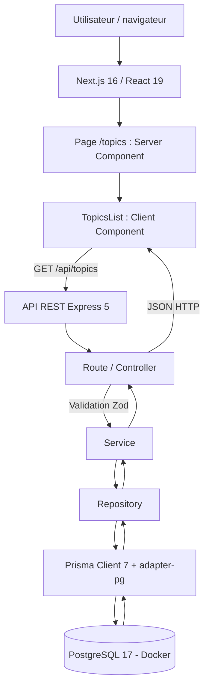
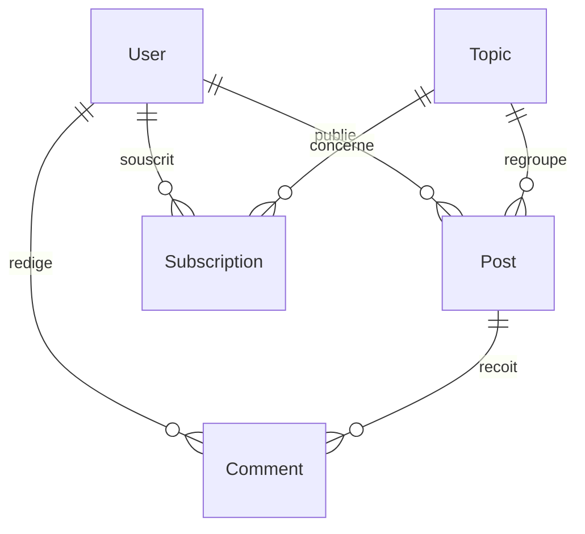

# Documentation et rapport technique — MDD (Monde de Dév)

**Projet :** P5 — OpenClassrooms, parcours Lead Developer JavaScript (RNCP 7)  
**Auteur :** Alain Bonneau
**Version du document :** 0.5.0 — profil utilisateur, abonnements et navigation responsive  
**Mise à jour :** 11/11/2026  
**Branches de référence :** `main` (authentification, abonnements, articles et commentaires intégrés) ; `feature/user-profile` (développement local, avant la fusion)  
**Commit historique de l'étape 4 :** `29a92b2`  
**État :** documentation évolutive de l'étape 4 et des fonctionnalités implémentées de l'étape 5

> **Périmètre de ce rapport :** distinguer les fonctionnalités réellement développées de celles prévues. Les contrôles manuels, les **80 tests automatisés réussis le 11/11/2026** et les commandes de compilation signalés comme validés proviennent des sorties communiquées par le développeur. Aucun taux de couverture ni résultat de mesure de performance n'est présumé. Les descriptions historiques de l'étape 4 sont conservées et distinguées de l'état actuel.

## Sommaire

1. [Présentation générale du projet](#1-présentation-générale-du-projet)
2. [Architecture et conception technique](#2-architecture-et-conception-technique)
3. [Tests, performance et qualité](#3-tests-performance-et-qualité)
4. [Documentation utilisateur et supervision](#4-documentation-utilisateur-et-supervision)
5. [Annexes et livrables](#5-annexes-et-livrables)

---

## 1. Présentation générale du projet

### 1.1 Objectifs du projet

MDD (Monde de Dév) est un réseau social destiné aux développeurs. Le MVP a pour objectif de permettre aux utilisateurs de consulter des thèmes liés à la programmation, de s'y abonner, de publier des articles et de participer à des échanges au moyen de commentaires.

Les principaux besoins métiers sont :

- **Découvrir** les sujets de programmation disponibles sur la plateforme.
- **Personnaliser** son expérience grâce aux abonnements aux thèmes.
- **Partager** des connaissances au moyen d'articles.
- **Échanger** autour des articles via les commentaires.

L'**étape 4** vise une preuve de fonctionnement limitée mais complète : afficher dans le navigateur une liste de thèmes obtenue depuis PostgreSQL, à travers le front-end Next.js et une API REST Express. Cette action valide la communication entre les différentes couches sans attendre l'implémentation du reste du MVP.

### 1.2 Périmètre fonctionnel et état d'avancement

| Fonctionnalité                     | Description                                                                                             | État au 11/11/2026                                                                             |
| ---------------------------------- | ------------------------------------------------------------------------------------------------------- | ---------------------------------------------------------------------------------------------- |
| Consultation des thèmes            | Lecture de `Topic` depuis PostgreSQL, affichage sur `/topics`                                           | **Implémentée et vérifiée** ; accès réservé aux utilisateurs connectés                         |
| Filtrage des thèmes dans l'API     | Paramètre facultatif `search` sur `GET /api/topics`                                                     | **Implémenté et vérifié manuellement**                                                         |
| Interface et navigation responsive | Cartes, logo officiel, header et panneau latéral mobile conforme à la maquette                          | **Implémentés**, vérifications desktop et mobile rapportées comme réussies                     |
| Inscription et connexion           | Validation Zod, hachage Argon2, sessions PostgreSQL et cookies HttpOnly                                 | **Implémentées et vérifiées**                                                                  |
| Déconnexion et contrôle d'accès    | Destruction de session, `GET /api/auth/me`, `requireAuth`, CSRF, rate limiting                          | **Implémentés et vérifiés**                                                                    |
| Abonnement / désabonnement         | Relation utilisateur–thème, boutons « S'abonner » / « Déjà abonné »                                     | **Implémentés et vérifiés** ; persistance contrôlée dans DBeaver                               |
| Articles                           | Liste et tri chronologique, publication, consultation détaillée                                         | **Implémentés** ; validation API et métier, essais manuels principaux                          |
| Commentaires                       | Affichage par article et publication par l’utilisateur connecté                                         | **Implémentés** ; validation API et métier, publication à conserver dans les preuves manuelles |
| Fil d'actualité personnalisé       | Articles correspondant aux thèmes suivis                                                                | À développer                                                                                   |
| Profil utilisateur                 | Consultation et mise à jour du compte, changement de mot de passe, affichage et gestion des abonnements | **Implémenté et vérifié manuellement** ; 17 tests automatisés dédiés réussis                   |

**Note :** le schéma de base de données contient déjà les entités nécessaires aux fonctionnalités futures et des données de démonstration. Cela ne signifie pas que leurs interfaces ou leurs endpoints métier sont disponibles.

---

## 2. Architecture et conception technique

### 2.1 Schéma global de l'architecture

Le schéma ci-dessous retrace **le cas end-to-end initial de l'étape 4**. Depuis, la route `/topics` a été placée dans un groupe Next.js protégé et les accès aux thèmes sont soumis à authentification. Les abonnements, les articles, les commentaires et la modification du profil passent par les mêmes couches, avec une session utilisateur et un jeton CSRF pour les mutations.



Depuis, les pages `/articles`, `/articles/new`, `/articles/[id]` et `/profile` ont également été ajoutées au groupe protégé. La création d’un article ou d’un commentaire suit la chaîne navigateur → Express (`requireAuth`, CSRF et validation Zod) → Service → Repository → Prisma/PostgreSQL.

L'application est organisée en **monorepo** :

```text
mdd/
├── frontend/
│   ├── app/(protected)/topics/page.tsx
│   ├── app/(protected)/articles/{page.tsx,new/page.tsx,[id]/page.tsx}
│   ├── app/(protected)/profile/page.tsx
│   ├── app/(protected)/layout.tsx
│   ├── app/login/page.tsx et app/register/page.tsx
│   ├── components/layout/site-header.tsx
│   ├── features/topics/components/topics-list.tsx
│   ├── features/articles/components/{articles-list,create-article-form,article-details}.tsx
│   ├── features/profile/components/profile-page.tsx
│   ├── features/auth/components/
│   ├── lib/api-client.ts
│   └── app/globals.css
├── backend/
│   ├── src/app.ts
│   ├── src/routes/{topics,auth,subscriptions,articles}.routes.ts
│   ├── src/controllers/{topics,auth,subscriptions,articles,comments}.controller.ts
│   ├── src/services/{topics,auth,subscriptions,articles,comments}.service.ts
│   ├── src/repositories/{topics,auth,subscriptions,articles,comments}.repository.ts
│   ├── src/middleware/{auth,csrf,rate-limit,session}.middleware.ts
│   ├── tests/ (Vitest et Supertest)
│   ├── src/lib/prisma.ts
│   ├── prisma/schema.prisma
│   ├── prisma/seed.ts
│   └── prisma7.config.ts
├── docs/REVUE_TECHNIQUE_ETAPE_4_MDD.md
├── docker-compose.yml
├── package.json
└── DOCUMENTATION.md
```

**Responsabilités :**

- **Client Component React** : déclenche les requêtes, affiche thèmes, abonnements, articles, commentaires et profil ; gère les états de chargement, d'erreur et de sauvegarde.
- **Next.js App Router** : pages d'inscription et de connexion ; groupe `(protected)` qui vérifie la session avant l'accès aux pages privées.
- **Express / Router / Controller** : expose les endpoints HTTP, applique `requireAuth`, la protection CSRF et les limites de requêtes, puis valide les entrées avec Zod.
- **Service** : porte la logique métier (authentification, abonnements, articles, commentaires et mise à jour du profil) et traduit les cas d'erreur.
- **Repository** : centralise les opérations Prisma, les requêtes et les champs sélectionnés.
- **Prisma / PostgreSQL** : fournit l'accès typé et persistant aux utilisateurs, thèmes, abonnements, articles, commentaires et sessions (ces dernières via `connect-pg-simple`).

### 2.2 Choix techniques et justifications

| Élément                                 | Rôle                                                       | Justification et compromis                                                                                                                                                                                         | Documentation                                                                                      |
| --------------------------------------- | ---------------------------------------------------------- | ------------------------------------------------------------------------------------------------------------------------------------------------------------------------------------------------------------------ | -------------------------------------------------------------------------------------------------- |
| Next.js 16, App Router                  | Front-end, routage et composants React                     | Structure de pages, métadonnées et séparation Server / Client Components.                                                                                                                                          | [Next.js](https://nextjs.org/docs)                                                                 |
| React 19 + TypeScript                   | Interfaces interactives et typage                          | Composants réutilisables et détection précoce d'erreurs de types.                                                                                                                                                  | [React](https://react.dev), [TypeScript](https://www.typescriptlang.org/docs/)                     |
| Express 5                               | API REST indépendante                                      | Séparation explicite front-end / back-end, possibilité de clients multiples, organisation par couches et tests d'API indépendants. En contrepartie : CORS, configuration de l'URL et déploiement de deux services. | [Express](https://expressjs.com/)                                                                  |
| Prisma 7 + `@prisma/adapter-pg`         | ORM et accès PostgreSQL                                    | Modèles typés, migrations versionnées et requêtes structurées.                                                                                                                                                     | [Prisma](https://www.prisma.io/docs)                                                               |
| PostgreSQL 17 + Docker Compose          | Stockage relationnel local                                 | Relations et contraintes adaptées aux utilisateurs, thèmes, articles et commentaires ; reproductibilité de l'environnement.                                                                                        | [PostgreSQL](https://www.postgresql.org/docs/), [Docker Compose](https://docs.docker.com/compose/) |
| Zod 4                                   | Validation                                                 | Contrôle des paramètres d'API et validation de la structure des réponses reçues côté front-end.                                                                                                                    | [Zod](https://zod.dev/)                                                                            |
| Tailwind CSS 4                          | Styles / responsive                                        | Mise en forme par utilitaires, adaptation aux maquettes desktop et mobile.                                                                                                                                         | [Tailwind CSS](https://tailwindcss.com/docs)                                                       |
| Helmet et CORS                          | Configuration HTTP                                         | En-têtes de protection et restriction des origines navigateur autorisées. Ne remplacent pas une authentification.                                                                                                  | [Helmet](https://helmetjs.github.io/), [CORS](https://github.com/expressjs/cors)                   |
| Argon2                                  | Hachage de mots de passe                                   | Utilisé pour les comptes fictifs du seed et pour les inscriptions ; vérification des mots de passe à la connexion.                                                                                                 | [argon2](https://www.npmjs.com/package/argon2)                                                     |
| GitHub Flow                             | Travail collaboratif                                       | Branches de fonctionnalités, Pull Requests et revue avant fusion ; articles et commentaires intégrés à `main`, profil sur `feature/user-profile` avant revue et fusion.                                            | [GitHub Flow](https://docs.github.com/en/get-started/using-github/github-flow)                     |
| `express-session` + `connect-pg-simple` | Sessions utilisateurs                                      | Identifiant en cookie HttpOnly ; contenu de session stocké dans PostgreSQL plutôt que dans le navigateur.                                                                                                          | [Express Session](https://github.com/expressjs/session)                                            |
| Middleware CSRF et `express-rate-limit` | Sécurité des mutations et des endpoints d'authentification | Jeton synchroniseur associé à la session, contrôle sur POST/PATCH/DELETE et limitation des tentatives de connexion/inscription.                                                                                    | [express-rate-limit](https://express-rate-limit.mintlify.app/)                                     |
| Vitest + Supertest                      | Tests automatisés du back-end                              | Vérification des réponses HTTP et des règles métier avec mocks ; aucune écriture sur les comptes réels durant ces tests.                                                                                           | [Vitest](https://vitest.dev/), [Supertest](https://github.com/ladjs/supertest)                     |

**Choix Express plutôt que Server Actions :** l'énoncé recommande un Client Component communiquant avec une Server Action. Le projet utilise, à la place, un Client Component appelant une **API REST Express séparée**. La chaîne complète front-end → back-end → base est ainsi effectivement traversée. Cet écart à la recommandation doit être **présenté et validé avec le mentor** pour vérifier qu'il satisfait l'évaluation ; il n'est pas assimilé à une Server Action.

### 2.3 API REST et schémas de données

#### Endpoints disponibles

| Endpoint                      | Méthode | Fonction                                                                                                            | État        |
| ----------------------------- | ------- | ------------------------------------------------------------------------------------------------------------------- | ----------- |
| `/api/health`                 | GET     | Vérification du service Express                                                                                     | Fonctionnel |
| `/api/health/db`              | GET     | Vérification de la connexion Prisma/PostgreSQL par comptage des thèmes                                              | Fonctionnel |
| `/api/topics`                 | GET     | Liste des thèmes, tri alphabétique, maximum 50 résultats ; session requise                                          | Fonctionnel |
| `/api/topics?search=react`    | GET     | Filtrage partiel du nom, insensible à la casse ; session requise                                                    | Fonctionnel |
| `/api/auth/csrf`              | GET     | Jeton CSRF associé à la session                                                                                     | Fonctionnel |
| `/api/auth/register`          | POST    | Inscription, validation et hachage Argon2 ; CSRF requis                                                             | Fonctionnel |
| `/api/auth/login`             | POST    | Vérification des identifiants et création de session ; CSRF requis                                                  | Fonctionnel |
| `/api/auth/me`                | GET     | Informations de l'utilisateur connecté                                                                              | Fonctionnel |
| `/api/auth/me`                | PATCH   | Modification du pseudo, de l'email et facultativement du mot de passe ; session, mot de passe actuel et CSRF requis | Fonctionnel |
| `/api/auth/logout`            | POST    | Invalidation de session ; CSRF requis                                                                               | Fonctionnel |
| `/api/subscriptions`          | GET     | Liste des abonnements avec nom et description des thèmes suivis                                                     | Fonctionnel |
| `/api/subscriptions`          | POST    | Abonnement à un thème ; session et CSRF requis                                                                      | Fonctionnel |
| `/api/subscriptions/:topicId` | DELETE  | Désabonnement ; session et CSRF requis                                                                              | Fonctionnel |
| `/api/articles?sort=newest`   | GET     | Liste de 50 articles maximum, tri du plus récent au plus ancien (ou `oldest`)                                       | Fonctionnel |
| `/api/articles/:id`           | GET     | Détail intégral, auteur, thème et commentaires                                                                      | Fonctionnel |
| `/api/articles`               | POST    | Création d'un article par l'utilisateur connecté ; CSRF requis                                                      | Fonctionnel |
| `/api/articles/:id/comments`  | POST    | Publication d'un commentaire ; session et CSRF requis                                                               | Fonctionnel |

Les routes `/api/topics`, `/api/subscriptions` et `/api/articles` exigent une session authentifiée. Le `userId` utilisé pour les abonnements provient de la session Express et non du corps HTTP. Les mutations sont contrôlées par la protection CSRF globale. Les auteurs des articles et des commentaires sont déterminés à partir de la session, jamais depuis un `authorId` fourni par le client. La modification du profil utilise également l’identifiant de session et exige la vérification du mot de passe actuel.

Pour `GET /api/topics`, le paramètre `search` est facultatif, une chaîne après suppression des espaces superflus, limitée à **100 caractères**. Le contrôleur utilise `z.strictObject()` : les paramètres inconnus sont rejetés avec **HTTP 400**. L'accès aux données est limité à `id`, `name` et `description`, dans l'ordre alphabétique des noms.

**Exemple de réponse :**

```json
{
  "data": [
    {
      "id": "b973d172-6221-4246-b91c-1bb8ccda1a74",
      "name": "React",
      "description": "Bibliothèque de création d'interfaces."
    }
  ]
}
```

Pour une recherche ne correspondant à aucun thème, la réponse attendue est `{ "data": [] }`. Une requête telle que `?search%5B%5D=React` reçoit **HTTP 400** après correction de la validation.

**Articles :** `GET /api/articles` accepte `sort=newest` (défaut) ou `sort=oldest`. La liste renvoie des extraits de contenu (180 caractères au maximum, avec une ellipse si le texte est tronqué). `POST /api/articles` valide un titre de 5 à 255 caractères, un contenu de 20 à 10 000 caractères et un `topicId` au format UUID. Le thème absent reçoit `404`.

**Commentaires :** `POST /api/articles/:id/comments` accepte un contenu non vide de 2 000 caractères au maximum. Un UUID invalide reçoit `400` ; un article absent reçoit `404`. Les commentaires sont inclus dans le détail de l'article, avec le pseudo de leur auteur, triés par date de création.

**Profil :** `PATCH /api/auth/me` utilise `z.strictObject()` pour contrôler le pseudo, l’email, le mot de passe actuel et, si renseigné, le nouveau mot de passe (12 à 128 caractères). Argon2 vérifie le mot de passe actuel et hache le nouveau. Une erreur de données reçoit `400`, une session ou un mot de passe invalide `401`, et un pseudo ou email déjà utilisé `409`. Le hash n’est jamais renvoyé au client.

#### Modèle relationnel

Le schéma Prisma définit cinq modèles métier :

| Modèle         | Identifiant / contrainte                     | Relations essentielles                        |
| -------------- | -------------------------------------------- | --------------------------------------------- |
| `User`         | UUID ; `email` et `username` uniques         | Auteur de posts et commentaires ; abonnements |
| `Topic`        | UUID ; `name` unique                         | Posts et abonnements                          |
| `Subscription` | Clé primaire composite (`userId`, `topicId`) | Lien entre User et Topic                      |
| `Post`         | UUID ; index sur thème/date et auteur        | Auteur User, thème Topic, commentaires        |
| `Comment`      | UUID ; index sur article/date et auteur      | Auteur User, article Post                     |



La migration initiale est versionnée dans `backend/prisma/migrations/`. Le seed `backend/prisma/seed.ts` crée deux utilisateurs fictifs, quatre thèmes, quatre abonnements, deux articles et deux commentaires. Les données ont été vérifiées dans DBeaver. Les requêtes `upsert` évitent de dupliquer ces données lors d'une relance. **Aucune nouvelle migration Prisma n'a été nécessaire pour les abonnements, les articles, les commentaires ou la modification du profil**, car les modèles `Subscription`, `Post` et `Comment` existaient déjà.

---

## 3. Tests, performance et qualité

### 3.1 Stratégie de test et résultats

Les vérifications ci-dessous documentent **le parcours initial de l'étape 4**. Elles ont été rapportées par le développeur sur son environnement local. Les résultats plus récents de l'étape 5 sont précisés après ce tableau.

| Test / vérification                                         | Attendu                                          | Résultat / état                                                  |
| ----------------------------------------------------------- | ------------------------------------------------ | ---------------------------------------------------------------- |
| `GET /api/topics`                                           | Quatre thèmes de démonstration                   | **Réussi** : JavaScript, Node.js, React, TypeScript              |
| `GET /api/topics?search=react`                              | React uniquement                                 | **Réussi**                                                       |
| `GET /api/topics?search[]=React` avant correction           | Paramètre rejeté                                 | **Anomalie observée** : tous les thèmes retournés                |
| Même requête après `z.strictObject()`                       | HTTP 400                                         | **Réussi**, confirmé manuellement                                |
| Page `/topics`                                              | Données de l'API affichées dans le navigateur    | **Validée manuellement** par le développeur                      |
| Présentation desktop / mobile                               | Grille à deux / une colonne et navigation mobile | **Vérifications rapportées comme réussies** ; captures à joindre |
| `npm --prefix frontend run lint`                            | Aucun échec bloquant                             | **Réussi**, confirmé par le développeur                          |
| `npm --prefix frontend run build`                           | Compilation sans erreur                          | **Réussi**, confirmé par le développeur                          |
| `npm --prefix backend run typecheck`                        | Aucune erreur de typage                          | **Réussi**, confirmé par le développeur                          |
| API indisponible / bouton « Réessayer »                     | Message d'erreur puis récupération               | **À consigner par un test dédié**                                |
| Tests unitaires, d'intégration automatisés, E2E automatisés | Exécution reproductible                          | **Non encore mis en place à l'étape 4** ; couverture non mesurée |

**Résultats actuels, étape 5 (11/11/2026) :**

| Vérification                             | Résultat communiqué                                                                                                                             |
| ---------------------------------------- | ----------------------------------------------------------------------------------------------------------------------------------------------- |
| `npm --prefix backend run test`          | **80 tests réussis / 10 fichiers** (15 authentification, 17 abonnements, 31 articles/commentaires, 17 profil)                                   |
| `npm --prefix backend run typecheck`     | **Réussi**, aucune erreur TypeScript                                                                                                            |
| `npm --prefix frontend run lint`         | **Réussi**, aucune erreur ESLint                                                                                                                |
| `npm run build`                          | **Réussi** : Next.js 16.4.3, génération Prisma Client 7.10.1 et compilation back-end                                                            |
| Parcours d'abonnement/désabonnement      | **Validé manuellement**, changement du bouton, persistance au rechargement, vérification dans DBeaver                                           |
| Accès à `/topics` sans session           | **Redirection vers `/login` confirmée** ; API protégée                                                                                          |
| Liste, création et détail des articles   | **Parcours principaux validés manuellement** ; le scénario manuel « UUID valide d'article inexistant » reste à confirmer                        |
| Publication de commentaires              | Fonctionnalité implémentée ; contrôles TypeScript, lint, build et tests HTTP/métier réussis ; conserver une preuve manuelle du parcours complet |
| Page `/profile` et abonnements affichés  | **Fonctionnement manuel confirmé** ; données du compte, cartes des thèmes suivis, suppression des abonnements et responsive                     |
| Tests du profil                          | **17 nouveaux tests réussis** (10 tests HTTP, 7 tests métier dont vérification réelle Argon2)                                                   |
| Panneau latéral mobile                   | **Adapté à la maquette Figma**, validation visuelle et responsive signalées                                                                     |
| Tests HTTP articles/commentaires         | **20 nouveaux tests réussis** avec sessions et services simulés                                                                                 |
| Tests des services articles/commentaires | **11 nouveaux tests réussis** (8 Articles, 3 Commentaires)                                                                                      |

Les tests Vitest et Supertest exécutés comprennent des tests HTTP avec services simulés et des tests du service métier avec repository simulé, y compris pour la mise à jour du profil. Les tests automatisés ne réalisent pas d'écritures réelles dans PostgreSQL. Le contrôle manuel dans DBeaver pour les abonnements complète cette validation sans constituer un test d'intégration automatisé avec base de données.

**Travaux de tests restant à mener :** tests de composants React (React Testing Library), tests E2E (Playwright), tests d'intégration sur une base PostgreSQL dédiée, scénarios de panne réseau, mesure de couverture. **Aucun taux de couverture n'est annoncé à ce stade.**

### 3.2 Performance et optimisations

Aucun score Lighthouse ni mesure chiffrée de latence ou de charge n'a encore été produit. Les décisions actuelles visent à éviter les traitements inutiles :

- Le repository des thèmes sélectionne uniquement les champs nécessaires (`id`, `name`, `description`).
- Les articles en liste sont limités à 50 entrées ; le service renvoie des extraits de 180 caractères au lieu du contenu intégral.
- La liste est triée côté base et limitée à **50** résultats par requête.
- `AbortController` annule la récupération côté navigateur lorsque le composant est démonté.
- Les ressources Next.js et Express se compilent séparément et peuvent être contrôlées indépendamment.

**Limites / travaux ultérieurs :** mesurer les performances et l'accessibilité, étudier une pagination si le nombre de thèmes augmente, évaluer les besoins de cache et conserver les résultats des audits dans cette section. L'avertissement Next.js sur la présence de plusieurs fichiers `package-lock.json` n'a pas bloqué les builds précédents ; sa configuration pourra être clarifiée ultérieurement.

### 3.3 Revue technique — première fonctionnalité end-to-end

La revue a porté sur **le comportement de l'API, la conformité à la maquette et les frontières de responsabilité entre les couches**.

| Observation                                                                             | Risque ou écart                                                                  | Décision / correction                                                                              |
| --------------------------------------------------------------------------------------- | -------------------------------------------------------------------------------- | -------------------------------------------------------------------------------------------------- |
| Le schéma initial utilisait `z.object()` pour les paramètres HTTP                       | Un paramètre inconnu `search[]` était ignoré et tous les thèmes étaient renvoyés | Passage à `z.strictObject()` et test manuel de non-régression                                      |
| Première UI générée : titre « Explorer les thèmes », recherche visible, cartes blanches | Écart avec la maquette officielle « Thèmes »                                     | Header MDD, grille responsive, cartes gris clair, suppression de la recherche visible              |
| La maquette présente « S'abonner » et « Déjà abonné »                                   | Absence d'authentification et de gestion d'abonnement côté API                   | Boutons **désactivés** ; aucune action métier fictive                                              |
| Logo en forme de nuage et liens incomplets                                              | Identité graphique / navigation encore provisoires                               | Remplacer par les assets officiels et finaliser après l'étape 4                                    |
| Client Component avec `fetch` direct vers Express                                       | Dépendance à l'URL d'API et à CORS                                               | Configuration `NEXT_PUBLIC_API_URL` facultative et origine Express autorisée ; documenter le choix |
| Absence de tests automatisés                                                            | Risque de régression                                                             | Prévoir tests API et interface ; ne pas déclarer de couverture fictive                             |

**Points forts :** code organisé par couches, types TypeScript, validation des entrées et de la réponse, gestion des états d'interface, lecture réelle des données PostgreSQL.

Les décisions de ce tableau sont **historiques** : depuis l'étape 4, le logo officiel a été intégré, les abonnements sont opérationnels et les tests automatisés ont été ajoutés. Les routes privées sont maintenant protégées par la session Express et les mutations par un jeton CSRF.

**Revue détaillée de l'étape 4 :** [docs/REVUE_TECHNIQUE_ETAPE_4_MDD.md](docs/REVUE_TECHNIQUE_ETAPE_4_MDD.md).

---

## 4. Documentation utilisateur et supervision

### 4.1 FAQ utilisateur — version de démonstration

**Q. Comment accéder à la liste des thèmes ?**  
R. Démarrer PostgreSQL puis l'application (`npm run db:up` et `npm run dev`), se connecter via `http://localhost:3000/login`, puis ouvrir `http://localhost:3000/topics`. Sans session valide, l'accès redirige vers la page de connexion.

**Q. D'où viennent les thèmes affichés ?**  
R. Ils proviennent de la base PostgreSQL via l'API Express `GET /api/topics`. Le front-end ne contient pas de liste statique de thèmes.

**Q. Comment s'abonner ou se désabonner d'un thème ?**  
R. Après connexion, ouvrir `/topics` et cliquer sur « S'abonner ». Le bouton devient « Déjà abonné ». Cliquer à nouveau permet de se désabonner ; les modifications sont enregistrées dans PostgreSQL et conservées après actualisation.

**Q. Que faire si les thèmes ne s'affichent pas ?**  
R. Vérifier que Docker/PostgreSQL et l'API Express fonctionnent, que la session est valide, puis tester `http://localhost:4000/api/health/db` et recharger la page. En cas d'erreur, utiliser « Réessayer ». Un appel direct à `/api/topics` sans cookie de session renvoie `401`, ce qui est attendu.

**Q. Comment créer et consulter un article ?**  
R. Se connecter, ouvrir `/articles`, cliquer sur « Créer un article », renseigner un thème, un titre et un contenu, puis cliquer sur « Créer ». L’article apparaît dans la liste et sa carte ouvre `/articles/[id]`.

**Q. Comment commenter un article ?**  
R. Depuis sa page de détail, saisir un commentaire puis utiliser le bouton d’envoi. Le commentaire est lié à l’utilisateur connecté et à l’article consulté.

**Q. Comment modifier mon profil et retrouver mes abonnements ?**  
R. Après connexion, utiliser l’icône Profil (en bas du panneau mobile ou dans la barre desktop), puis accéder à `/profile`. Le pseudo et l’email sont préremplis ; la sauvegarde nécessite le mot de passe actuel. Le changement de mot de passe est facultatif. En bas de la page, les thèmes suivis sont affichés avec un bouton « Se désabonner ».

### 4.2 Supervision et tâches déléguées à l'IA

Pour répondre à l'exigence de posture Lead Developer, une tâche circonscrite a été confiée à **ChatGPT**, puis examinée et corrigée par le développeur responsable.

| Tâche confiée                                                     | Attendus                                                                                                 | Revue humaine                                                                                       | Décision                                                       |
| ----------------------------------------------------------------- | -------------------------------------------------------------------------------------------------------- | --------------------------------------------------------------------------------------------------- | -------------------------------------------------------------- |
| Proposition de la page Next.js `/topics` et d'un Client Component | Appeler Express, afficher des données PostgreSQL, gérer chargement/erreur/vide, être responsive          | Test dans le navigateur et comparaison aux maquettes transmises                                     | Proposition initiale corrigée avant conservation               |
| Mise en forme de la page Thèmes                                   | Header MDD, deux colonnes desktop, une mobile, cartes et boutons conformes aux intentions de la maquette | Signalement de la non-conformité visuelle initiale                                                  | Adaptation du composant et retrait de la recherche visible     |
| Analyse du cas d'API `search[]=React`                             | Rejeter les paramètres imprévus                                                                          | Reproduction de l'anomalie et vérification après modification                                       | Adoption de `z.strictObject()`                                 |
| Rédaction de la revue et de la documentation                      | Traces des décisions, validations et limites                                                             | À vérifier par le responsable avant le dépôt final                                                  | Documents versionnés ; export PDF restant à effectuer          |
| Proposition de l'authentification et de ses tests                 | Inscription, connexion, sessions, déconnexion, CSRF, rate limiting et code testable                      | Intégration, contrôles manuels et exécution de 15 tests par le développeur                          | Fonctionnalité validée ; protection des routes privées ajoutée |
| Proposition des abonnements et de leurs tests                     | Création/suppression, contrôle des doublons, mise à jour du front et protection de session               | Vérifications fonctionnelles, persistance dans DBeaver et exécution de 17 nouveaux tests            | Fonctionnalité validée ; intégrée à `main`                     |
| Proposition des articles, commentaires et tests                   | Liste/tri, publication, détail, commentaires, contrôles de session et CSRF                               | Ajustements des pages à partir des maquettes, exécution de 31 nouveaux tests, typage, lint et build | Fonctionnalités intégrées à `main`                             |
| Proposition du profil, navigation et tests                        | Lecture et modification du profil, thèmes suivis, mot de passe sécurisé et maquettes                     | Contrôles manuels, ajustement du panneau mobile et exécution de 17 tests supplémentaires            | Fonctionnalité validée localement ; revue et PR à finaliser    |

**Critères d'acceptation de la délégation (étape 4) :** données réelles, séparation claire des responsabilités, absence d'action d'abonnement simulée **à ce stade**, états UI appropriés, adaptation responsive et tests reproductibles. Pour l'étape 5 s'ajoutent le contrôle des sessions, la gestion des permissions, le CSRF, l'intégrité des relations et des tests HTTP/métier reproductibles.

**Enseignement de la supervision :** une proposition de l'IA peut être fonctionnelle sans être conforme au besoin. La validation humaine a notamment permis de repérer une erreur de comportement HTTP et un écart à la maquette Figma. Le développeur conserve la responsabilité des choix d'architecture, des corrections, de la validation et de la livraison.

**Traçabilité :** commit initial `29a92b2`, branche `feature/topics-e2e`, [rapport de revue](docs/REVUE_TECHNIQUE_ETAPE_4_MDD.md) et [Pull Request #2 fusionnée](https://github.com/AlainDev97/DFSJS-Prenez-en-charge-le-d-veloppement-d-une-application-full-stack-JavaScript-compl-te/pull/2). L'authentification a été fusionnée dans `main`. Les abonnements ont été fusionnés dans `main`. Les articles et commentaires sont intégrés à `main`. Le profil est en cours de finalisation sur `feature/user-profile` ; le numéro de sa Pull Request et la fusion restent à consigner.

---

## 5. Annexes et livrables

### 5.1 Livrables de l'étape 4

| Élément demandé                                                | Situation                                                                                                          |
| -------------------------------------------------------------- | ------------------------------------------------------------------------------------------------------------------ |
| Application web exécutable, avec une action du front à la base | **Réalisée** : page `/topics` → Express → Prisma → PostgreSQL                                                      |
| Choix techniques documentés                                    | **Présents** dans les sections 2.1 à 2.3                                                                           |
| Délégation et revue du travail de l'IA                         | **Présentes** en 3.3, 4.2 et dans le rapport dédié                                                                 |
| Tests et contrôle qualité                                      | **Vérifications manuelles et compilation rapportées** pour l'étape 4 ; tests automatisés ajoutés lors de l'étape 5 |
| Document PDF mis à jour                                        | **À exporter** à partir de la version relue du présent document                                                    |

### 5.2 Pièces justificatives à ajouter

- Captures des maquettes « Thèmes » desktop et mobile et de leur implémentation réelle.
- Résultats visibles des appels `GET /api/topics`, `?search=react` et du rejet des paramètres inconnus.
- Captures ou exports des commandes lint, build et typecheck réussies (nouveau build à confirmer après modification du menu mobile).
- Captures desktop/mobile du profil, des thèmes suivis et du nouveau panneau latéral.
- Test spécifique de l'erreur réseau et du bouton « Réessayer ».
- Lien vers la Pull Request et, après revue, son état final.
- Résultats Vitest **déjà exécutés** (80 tests réussis le 11/11/2026) ; rapports Playwright et audits Lighthouse à ajouter seulement s'ils sont effectivement réalisés.

### 5.3 Étape 5.1 — Authentification des utilisateurs

**Objectif :** permettre aux utilisateurs de créer un compte, de se connecter, de conserver leur session et de se déconnecter.

**Architecture :** Next.js 16 pour les interfaces, API REST Express avec séparation Controller / Service / Repository, Prisma et PostgreSQL pour les utilisateurs et les sessions.

**Fonctionnalités implémentées :**

- Inscription avec validation Zod et hachage Argon2.
- Connexion avec vérification des identifiants et création d'une session.
- Consultation de l'utilisateur connecté.
- Déconnexion et destruction de la session.
- Protection CSRF et limitation des tentatives.
- Middleware de protection des routes privées.

**Validation technique :** 15 tests d'authentification validés avec Vitest et Supertest (10 tests HTTP, 2 tests de limitation et 3 tests du service Argon2), dont les trois tests complémentaires du service exécutés avec succès le 09/11/2026. Vérifications TypeScript, lint front-end et build complet réussies.

**Délégation et supervision des tests automatisés**

La rédaction initiale des tests automatisés d'authentification a été déléguée à une intelligence artificielle (ChatGPT).

En tant que Lead Developer, j'ai assuré la supervision de cette tâche en définissant les fonctionnalités à tester, en examinant le code généré, en intégrant les tests dans le projet et en exécutant leur validation avec Vitest et Supertest.

Cette approche m'a permis de vérifier la conformité des tests aux besoins fonctionnels et aux choix architecturaux du projet, tout en conservant la responsabilité de leur validation finale.

Les 12 premiers tests automatisés ont été exécutés avec succès, puis 3 tests supplémentaires ont confirmé le hachage Argon2, la vérification d'un mot de passe valide et le refus d'un mot de passe incorrect.

**Limites identifiées :** les compteurs de limitation de débit sont stockés en mémoire ; un stockage partagé sera nécessaire en environnement multi-instance. Les paramètres HTTPS, les cookies et le proxy inverse devront être validés avant un déploiement en production.

**Conclusion :** le module d'authentification est fonctionnel, vérifié manuellement et couvert par 15 tests automatisés. La couverture chiffrée n'a pas été mesurée ; les scénarios E2E restent à implémenter.

### 5.4 Étape 5.2 — Abonnements aux thèmes

**Objectif :** permettre aux utilisateurs authentifiés de s'abonner et de se désabonner des thèmes proposés sur MDD, avec conservation de l'état après actualisation.

**Architecture :** la page Next.js `/topics` s'appuie sur l'API REST Express, organisée en Router / Controller / Service / Repository. Les données sont persistées dans PostgreSQL via Prisma et le modèle `Subscription` existant, dont la clé composite (`userId`, `topicId`) empêche les doublons.

**Fonctionnalités implémentées :**

- Liste des thèmes et récupération des abonnements de l'utilisateur connecté.
- Création et suppression d'un abonnement, avec mise à jour immédiate du bouton « S'abonner » / « Déjà abonné ».
- Conservation des abonnements après rechargement de la page.
- Protection des pages privées par le groupe Next.js `(protected)` et des routes Express par `requireAuth`.
- Utilisation de l'identifiant de l'utilisateur issu de la session ; protection CSRF sur les requêtes de modification.
- Gestion des erreurs métier : thème absent (`404`), doublon (`409`), données invalides (`400`) ; désabonnement idempotent (`204`).

**Validation technique :** 17 tests supplémentaires ont été exécutés avec succès (12 tests API/HTTP et 5 tests du service métier), portant le total à **32 tests réussis sur 5 fichiers**. Le 09/11/2026, les commandes de vérification TypeScript back-end, ESLint front-end et build complet ont réussi. Le parcours d'abonnement et de désabonnement a été validé manuellement dans le navigateur, puis la persistance a été vérifiée dans DBeaver.

**Délégation et supervision de l'IA :** les propositions d'implémentation et de tests ont été produites avec l'aide de ChatGPT. Le développeur les a intégrées et a vérifié leur comportement par compilation, tests automatisés, essais de navigation, contrôle des sessions et inspection de la table `Subscription`. La responsabilité des choix et de la validation reste humaine.

**Limites identifiées :** les tests API et service utilisent des mocks et ne couvrent pas encore un cycle automatisé complet sur une base PostgreSQL de test. Les tests E2E navigateur et la mesure de couverture sont à réaliser ultérieurement. Les abonnements sont intégrés à `main` ; les tests E2E de leur parcours restent à réaliser.

**Conclusion :** les abonnements aux thèmes sont fonctionnels et validés localement pour le MVP ; la fonctionnalité est intégrée à `main`.

### 5.5 Étape 5.3 — Articles et commentaires

**Objectif :** permettre aux utilisateurs connectés de consulter et publier des articles, puis de participer à leurs discussions.

**Architecture :** Next.js App Router pour `/articles`, `/articles/new` et `/articles/[id]`, sous le layout `(protected)` ; API REST Express avec Controller / Service / Repository ; persistance Prisma/PostgreSQL sur `Post` et `Comment`. Les auteurs proviennent de `req.session.userId` et les opérations POST exigent un jeton CSRF.

**Fonctionnalités implémentées :**

- Liste des articles avec titre, date, auteur, extrait, responsive et tri chronologique (`newest` / `oldest`).
- Formulaire de création avec sélection d'un thème, validation Zod et retour vers la liste après publication.
- Détail d'un article avec contenu intégral, thème, auteur, date et commentaires triés chronologiquement.
- Publication de commentaires par les utilisateurs connectés, suivie d'une actualisation des commentaires depuis l'API.
- Validation des UUID et des champs ; réponses HTTP dédiées aux erreurs de saisie, d'authentification, de CSRF et aux ressources inexistantes.
- Ajustements d'interface suivant les maquettes Figma : cartes des articles, formulaire centré, page de détail et bulles des commentaires.

**Endpoints :** `GET /api/articles`, `GET /api/articles/:id`, `POST /api/articles` et `POST /api/articles/:id/comments`.

**Validation technique :** 31 tests nouveaux ont été exécutés avec succès : 20 tests HTTP `articles.api.test.ts`, 8 tests `articles.service.test.ts` et 3 tests `comments.service.test.ts`. La suite atteint **63 tests réussis sur 8 fichiers le 11/11/2026**. Les commandes `npm --prefix backend run typecheck`, `npm --prefix frontend run lint` et `npm run build` ont également été rapportées comme réussies. Les tests de service utilisent des repositories simulés ; les tests HTTP utilisent des services simulés.

**Supervision de l'IA :** les premières propositions de code et de scénarios de test ont été fournies par ChatGPT. Le développeur a intégré et vérifié les solutions, fait ajuster les interfaces aux maquettes et exécuté les contrôles de qualité. Cette assistance ne remplace ni une revue du code ni sa compréhension pour la soutenance.

**Points encore ouverts :** confirmer manuellement le `404` pour un UUID d'article inexistant ; conserver la preuve d'un commentaire réellement enregistré et affiché après rafraîchissement ; ajouter à terme des tests de composants React, des E2E Playwright et des tests d'intégration avec une base dédiée. Aucun taux de couverture de code n'a été mesuré.

**Conclusion :** les parcours principaux des articles et commentaires sont développés et les 31 tests propres à ce module passent ; cette fonctionnalité a été intégrée à `main`.

### 5.6 Étape 5.4 — Profil utilisateur et navigation mobile

**Objectif :** permettre à l’utilisateur authentifié de consulter et modifier son compte et de retrouver les thèmes qu’il suit, conformément aux maquettes Figma.

**Architecture :** la page Next.js `/profile` est placée dans le groupe `(protected)` ; son composant React consomme `GET /api/auth/me`, `PATCH /api/auth/me` et `GET /api/subscriptions`. La mise à jour du profil suit Router → Controller → Service → Repository → Prisma/PostgreSQL. Le désabonnement réutilise `DELETE /api/subscriptions/:topicId`. Aucune migration Prisma supplémentaire n’a été nécessaire.

**Fonctionnalités implémentées :**

- Affichage du pseudo et de l’adresse email du compte connecté, avec formulaire responsive.
- Modification du pseudo et de l’email après vérification du mot de passe actuel.
- Changement facultatif du mot de passe ; nouveau mot de passe haché via Argon2.
- Affichage des thèmes suivis avec leur titre et description ; désabonnement immédiat sans rechargement manuel de la page.
- Accès au profil par l’icône du header desktop et du menu mobile. Le pseudo n’est pas ajouté au header : il ne figure pas dans la maquette demandée.
- Remplacement du menu déroulant mobile initial par un panneau latéral occupant toute la hauteur, avec fond estompé, navigation en haut et icône Profil en bas, selon la maquette.

**Sécurité et validation :** `PATCH /api/auth/me` nécessite une session valide, un jeton CSRF et le mot de passe actuel. Les entrées sont validées avec Zod (`z.strictObject()`), les doublons sont détectés par les contraintes uniques Prisma (`P2002`) et le hash du mot de passe n’est jamais exposé. La suppression d’abonnement utilise exclusivement le `userId` de la session Express.

**Tests et validation :** 17 tests automatisés supplémentaires ont été exécutés avec succès : 10 scénarios API (`profile.api.test.ts`) et 7 scénarios métier (`profile.service.test.ts`). Ces derniers vérifient notamment le mot de passe actuel, le hachage Argon2 d’un nouveau mot de passe, les doublons et la disparition d’un compte. La suite complète atteint **80 tests réussis sur 10 fichiers au 11/11/2026**. Les contrôles manuels du responsive, du désabonnement et de la présentation mobile ont été confirmés par le développeur. Le lint, le typecheck et le build **restent à reconfirmer après les tout derniers ajustements du menu mobile**, avant fusion.

**Délégation et supervision de l’IA :** ChatGPT a proposé la structure, le code initial et les scénarios de tests. Le développeur a intégré les fichiers, signalé les différences par rapport à Figma, validé les parcours et exécuté la suite Vitest. Les décisions et la validation finale restent sous sa responsabilité.

**Limites et travaux restants :** les tests HTTP/métier isolent les dépendances par mocks ; ils ne remplacent pas les tests E2E Playwright ou les tests de persistance sur une base dédiée. Aucun taux de couverture chiffré ni audit Lighthouse n’est encore disponible. La branche `feature/user-profile` est à relire, publier puis fusionner dans `main`.

**Conclusion :** le module Profil et son interface responsive sont développés et validés fonctionnellement. La livraison dans `main` dépend de la validation technique finale et de la Pull Request.

**Références du projet :**

- [Dépôt GitHub MDD](https://github.com/AlainDev97/DFSJS-Prenez-en-charge-le-d-veloppement-d-une-application-full-stack-JavaScript-compl-te)
- [Code de l'étape 4 sur `feature/topics-e2e`](https://github.com/AlainDev97/DFSJS-Prenez-en-charge-le-d-veloppement-d-une-application-full-stack-JavaScript-compl-te/tree/feature/topics-e2e)
- [Compte rendu de revue technique](docs/REVUE_TECHNIQUE_ETAPE_4_MDD.md)

_Document évolutif — dernière mise à jour : 11/11/2026._
